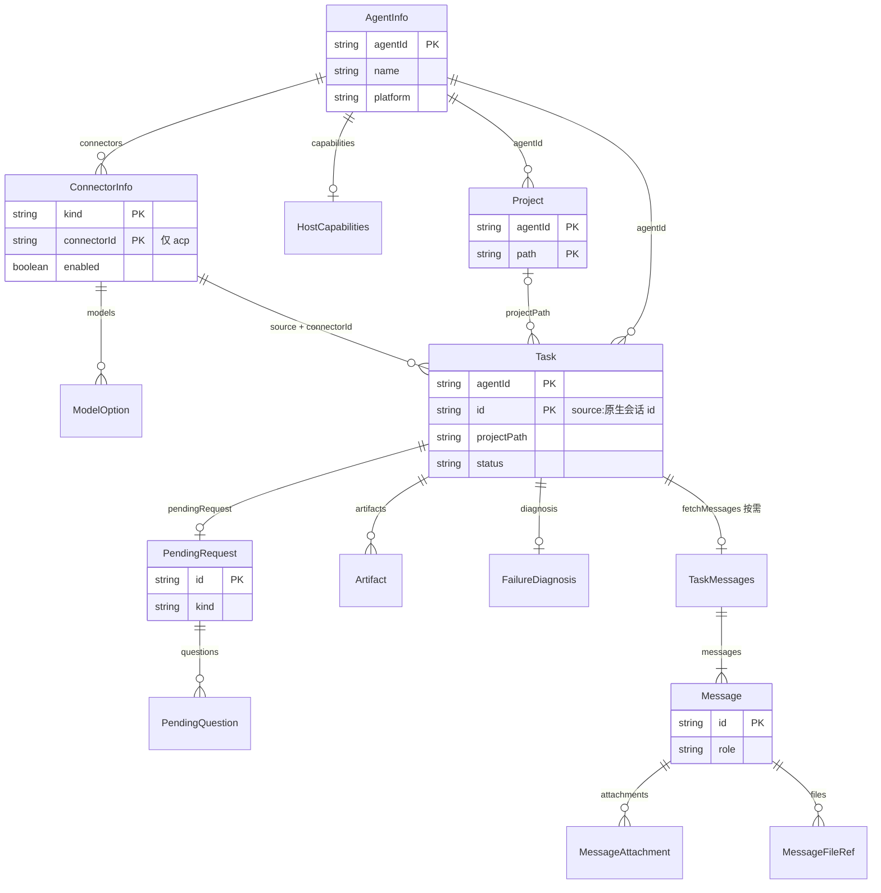
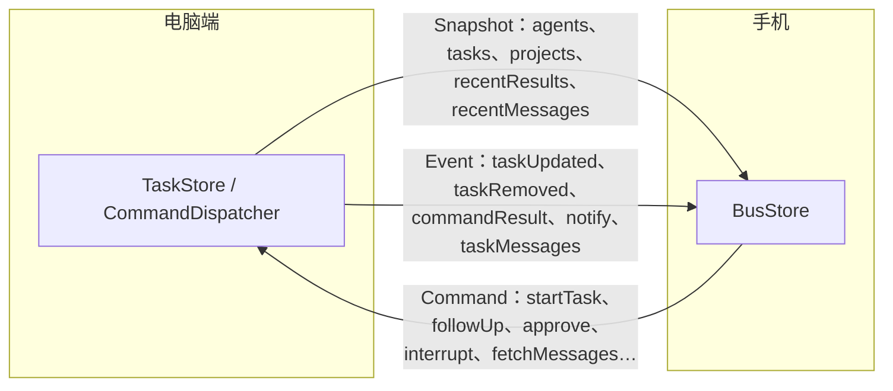

# 多 Agent 接入需求文档（采用 BotBus Protocol）

| 项 | 内容 |
| --- | --- |
| 文档状态 | 草稿 v1.1 |
| 日期 | 2026-10-13 |
| 路线 | **只采用开源的 [BotBus Protocol](https://github.com/botbus-io/botbus-protocol)**（线协议 / wire contract），不使用 BotBus 官方电脑端 App、手机 App 和托管 Relay |
| 交付物 | 手机 App 扩展（本仓库）、新的电脑端程序；现有 [dsh-scan-remote](https://github.com/yukiykchen/dsh-scan-remote) Relay 分阶段迭代 |
| 协议来源 | [botbus-io/botbus-protocol](https://github.com/botbus-io/botbus-protocol)（Apache-2.0），基线 **3.9**；规范正文见 [PROTOCOL.md](https://github.com/botbus-io/botbus-protocol/blob/main/PROTOCOL.md) |
| 关联文档 | [app-host-protocol.md](app-host-protocol.md)（DSH 原生协议） |
| 参考资料 | 完整链接清单见 [§10.2](#102-参考资料) |

> **名称说明：** 「BotBus Protocol」是上游开源仓库自己的正式名称（README 标题即为 *BotBus Protocol*），指手机与电脑之间交换 Snapshot / Event / Command 的线协议；仓库里另附 Swift 写的参考实现（协议类型与各 Agent 连接器）。它和 BotBus 商业/官方 App 不是一回事；本项目只实现该协议，产品中不使用「BotBus」品牌名与图标。

### 修订记录

| 版本 | 变化 |
| --- | --- |
| v0.1 | 先对接官方 BotBus 电脑端与托管 Relay，再逐步替换 |
| v0.2 | 只采用协议，三端自建；新增 Swift 电脑端与 Node 桥接 |
| v0.3 | 不再新建 Relay，复用现有 dsh-scan-remote Relay，分两阶段：第一阶段原样当加密隧道用，第二阶段在同一 Relay 上补存储转发与推送；第一阶段手机端不需要新的加密实现；Node 桥接复用插件代码 |
| v0.4 | 手机端不再是「DSH 通道 + 多 Agent 通道」两个并列入口，改为统一的 Agent 客户端：DSH 是其中一个 Agent，现有 DSH 页面作为 DSH 任务的完整视图；只装了 dsh 插件的旧配对也显示在统一列表里 |
| v0.5 | 2.3–2.5 由摘要扩成完整说明：领域对象字段、命令 / 事件、加密信封与 AAD、ACP 发现与子集 |
| v0.6 | 标题与文首明确「BotBus Protocol」是上游开源线协议正式名；§10.2 补全全部参考资料直达链接 |
| v0.7 | 2.3 改名「协议数据模型」，新增对象关系图与数据流向图 |
| v0.8 | 电脑端不再限定 Swift：2.7 改为选型（A：Swift 链接上游包；B：Node.js；C：其他语言），上游 Swift 代码作为参考实现；E14 改为与语言无关的电脑端需求，原 E15 并入（新增 E14.10 连接器） |
| v0.9 | 第 8 章只保留分期计划与里程碑，去掉人力与人日估算 |
| v1.0 | 第 6 章功能需求逐条补充「主流程」与「验收」（含状态 / 文案 / 映射规则表）；编号不变 |
| v1.1 | 第 5 章新增 5.1 页面清单、5.2 现有页面改造；未提交改动与合并 worktree（原 FR-9.5、FR-9.6、FR-14.5.4）和全屏图片查看器移出首期，相关章节同步删减 |

---

## 1. 背景与目标

### 1.1 现状

- **手机 App（本仓库）**：经扫码 Relay 或 SSH 连电脑上的 DeepSeek Harness（`dsh web`），使用 DSH 原生 RPC + `events.mux`。扫码模式已有完整的配对、`sealed-tunnel-v1` 加密隧道和本机 loopback 网关（`DshRelayManager`、`DshRelayLoopbackServer`、`SealedTunnelCrypto`）。
- **Relay（dsh-scan-remote/relay）**：Node.js + SQLite 的加密隧道服务，已部署在 `relay.dshmobile.online`，支持 Docker / Railway。有配对、token 哈希存储与撤销、限流与资源上限、管理后台。只转发密文字节，不理解内容；没有推送。
- **dsh 插件（dsh-scan-remote 根目录）**：跑在 `dsh web` 进程里，作为隧道的「设备端」出站连 Relay，把手机的请求转给本机 `127.0.0.1:3080`。

### 1.2 目标

把 App 从「只能连 DeepSeek Harness」扩展为能连电脑上大多数 AI 编程 Agent 的统一客户端。DSH 不再是单独的入口，而是统一 Agent 列表里的一员：

- **一档 Agent**（协议里有固定来源、电脑端有专属连接器）：DeepSeek Harness、Codex、Claude Code、Hermes、Pi、OpenClaw；
- **ACP Agent**（通用 ACP 连接器驱动，不逐家适配）：Gemini CLI、OpenCode、Qwen Code、Kimi CLI、Cursor、GitHub Copilot、Cline、goose 等任何实现了 Agent Client Protocol 的 agent；
- 能力：任务列表与进度、对话记录、续聊、中断、审批 / 回答提问、新建任务、收发图片与产物；第二阶段加推送通知与电脑离线时查看；
- 内容端到端加密。

### 1.3 分期

| 阶段 | Relay | 能做什么 | 限制 |
| --- | --- | --- | --- |
| 第一阶段 | 不改代码，原样当加密隧道，只转发、不存储 | 电脑端顶替 dsh 插件接入 Relay；手机用现有扫码与隧道，完成任务查看、续聊、中断、审批、新建任务等 | 手机和电脑必须同时在线；没有推送，只有 App 前台或后台服务运行时的本地通知 |
| 第二阶段 | 在同一服务里新增存储转发接口与推送，只存密文 | 电脑离线时查看最近快照；命令在 Relay 排队，电脑上线后执行；需要审批、任务完成时推送；已配对的电脑经隧道升级，不用重新扫码 | — |

详细设计见第 4 章，里程碑见第 8 章。

### 1.4 交付物

| 交付物 | 性质 | 语言 | 说明 |
| --- | --- | --- | --- |
| 手机 App | 扩展本仓库 | Kotlin（Kuikly / KMP） | 从「只能连 DSH」扩展为统一的多 Agent 客户端，DSH 是其中一个 Agent；现有 DSH 页面保留为 DSH 任务的完整视图 |
| 电脑端程序 | **新建** | 不限定，由实现方选型（见 2.7） | 发现本机 Agent，翻译成协议；第一阶段作为隧道的设备端接入现有 Relay |
| Relay | 迭代现有 dsh-scan-remote/relay | TypeScript | 第一阶段先不改；第二阶段在同一服务里补协议的存储转发接口与推送 |

### 1.5 首期非目标

- 远程桌面操作、「操作电脑」工作区（文件、终端）、开发服务器网页预览；
- 查看未提交改动与合并 worktree（协议的 `fetchChanges` / `mergeWorktree`）：电脑端报 `capabilities.fetchChanges: false`、不报 `worktrees`，手机不显示入口；
- 图片 / 产物的全屏查看器：图片只在对话气泡和产物列表里以缩略图显示，文件交给系统应用打开；
- 与 BotBus 官方 App 互通：我们只用协议，Relay、配对和凭据都是自己的，官方 App 连不上我们的电脑端，我们的手机也连不上官方的 Mac 端。

---

## 2. 调研结论

### 2.1 BotBus 的四层架构

```text
各家 Agent（各自原生协议）
  Codex app-server · Claude hooks / claude -p · dsh web + ACP · Hermes state.db ·
  Pi JSONL · OpenClaw Gateway · 任意 ACP agent（stdio JSON-RPC）
        ▲ 连接器：把原生格式翻成协议对象
电脑端：ConnectorRegistry · TaskStore · CommandDispatcher · ACP 发现与反向扩展
        ▲ WSS，只发密文
Relay：路由、保存快照、离线命令队列、产物暂存、推送；没有密钥
        ▲ HTTPS + WSS
手机：只认统一协议，从不解析任何 Agent 的原生格式
```

### 2.2 三条设计原则

1. **手机只解析统一协议。** 各 Agent 的原生格式全部由电脑端的连接器翻译成协议对象，手机不写任何 Agent 专属的解析代码。某个 Agent 改了格式，只更新电脑端，手机不用发版。
2. **接入新 Agent 不改协议。** `source` 只为一档 Agent 设固定值；其他 Agent 统一用 `source = acp`，用 `connectorId` 区分是哪一家，任务 id 写成 `acp:<connectorId>:<sessionId>`。新的 Agent 只要实现了 ACP，电脑端加一份清单文件就能接入，手机和协议都不用改。
3. **手机按能力字段决定显示什么。** 电脑端在 `AgentInfo.capabilities` 和 `ConnectorInfo` 的 `models`、`canAutoApprove`、`canDeleteTasks`、`canStartTask` 等可选字段里声明每个 Agent 能做什么；手机只显示声明了的入口，字段缺失时按「不支持」处理。不按 Agent 名字写死判断。

### 2.3 协议数据模型

基线为 BotBus Protocol **3.9**。手机与电脑端（第一阶段经隧道传明文，第二阶段密封后经 Relay）共用同一套对象。实现时以公开仓库的 `PROTOCOL.md`、`src/protocol.ts` 和 `protocol-fixtures/` 为准；本节先用两张图说明对象关系和数据流向，再逐个列字段。

#### 2.3.0 对象关系与数据流向

**对象关系。** 一台电脑（AgentInfo）上有多个 Agent（ConnectorInfo）和多个项目（Project）；每个任务（Task）属于一台电脑、由其中一个 Agent 产生、归入一个项目（或「不在项目中」）。审批、产物、失败诊断挂在任务上；对话记录不随快照下发，按需拉取。



唯一键：电脑是 `agentId`；Agent 是电脑内的 `(kind, connectorId)`；项目是 `(agentId, path)`；任务是 `(agentId, id)`。`Project` 与 `Task` 之间没有外键，靠 `Task.projectPath` 等于 `Project.path` 分组；`outsideProject` 的任务不属于任何项目。

**数据流向。** 上述对象不单独传输，而是装在三种载体里：



手机首次连接或收到 `snapshot` 事件时整体替换本地状态，之后用增量事件更新；每条 Command 的执行结果以 `commandResult` 事件（或快照里的 `recentResults`）返回。

#### 2.3.1 编码约定

| 约定 | 规则 |
| --- | --- |
| JSON 字段名 | camelCase |
| 时间 | ISO 8601 UTC，固定 `YYYY-MM-DDTHH:MM:SSZ`（秒精度，无小数）；Relay 用字典序比较时间 |
| 可选字段 | 缺省时**整键省略**，不写 `null` |
| 闭集枚举 | 遇到不认识的值 → **拒绝整条记录**（例如 `Task.source`、`TaskStatus`、`ConnectorInfo.kind`、`Artifact.kind`） |
| 开集枚举 / 字符串 | 遇到不认识的值 → **不拒收**，按「其他 / 忽略」处理（例如 `platform`、`FailureDiagnosis.kind`、模型强度词） |
| 规范 JSON（密封用） | 键按字典序、无多余空白；第一阶段明文路径也建议先实现，便于对照 fixture |

#### 2.3.2 三种载体

电脑与手机之间只经三种载体沟通：

| 载体 | 方向 | 作用 |
| --- | --- | --- |
| **Snapshot** | 电脑 → 手机 | 全量状态：电脑列表、任务、项目、近期命令结果 |
| **Event** | 电脑 → 手机 | 增量：`snapshot` / `taskUpdated` / `taskRemoved` / `commandResult` / `notify` / `taskMessages` |
| **Command** | 手机 → 电脑 | 操作；回执是 **CommandResult**（也可出现在快照的 `recentResults` 里） |

**Snapshot** 字段：

| 字段 | 类型 | 说明 |
| --- | --- | --- |
| `agents` | [AgentInfo] | 最多 10，按 name 升序；电脑端自己发出时恰好 1 个元素、`online = true` |
| `tasks` | [Task] | 合并后最多 400，按 `updatedAt` 降序 |
| `projects` | [Project] | 合并后最多 60 |
| `recentResults` | [CommandResult] | 最近 20 |
| `recentMessages` | [TaskMessages] | 最多 1 份（按需拉对话的结果暂存） |
| `seq` | integer | 单调序号；第一阶段本机 API 自己维护 |
| `generatedAt` | string | 生成时间 |

电脑离线时（第二阶段）：Relay 保留最后分片，只把 `online` 置 false，任务仍可查看、不可操作。组闲置 30 天可清任务内容但保留凭据。

**Command** 通用字段：`id`（客户端 UUID）、`createdAt`、`agentId`（目标电脑）、`kind`，以及与 `kind` 同名的唯一 payload 字段；其余 payload 应省略。整条密封后 ≤ 16 KiB（第二阶段）。

| kind | payload | 首期 |
| --- | --- | --- |
| `startTask` | `source`、`projectPath`、`prompt`；可选 `newProject`、`newProjectParent`、`attachments`、`connectorId`（acp 必填）、`model`、`effort`、`autoApprove`、`worktree` | P1 |
| `followUp` | `taskId`、`prompt`；可选 `attachments`、`model`、`effort`、`autoApprove` | P0 |
| `approve` | `taskId`、`requestId`、`decision`（`allow` / `deny`）；可选 `answers` | P0 |
| `interrupt` | `taskId` | P0 |
| `fetchMessages` | `taskId`；可选 `limit`（对话条数，≤ 40） | P0 |
| `fetchFile` | `taskId`、`messageId`、`path` | P1 |
| `fetchChanges` | `taskId` | **首期不做**（1.5） |
| `mergeWorktree` | `taskId` | **首期不做**（1.5） |
| `setConnectorEnabled` | `connector`、`enabled`；`connectorId`（acp 时必填） | P2 |
| `restartConnector` | 同上；仅电脑报了 `canRestartConnectors` | P2 |
| `deleteTask` | `taskId`；仅 Agent 报了 `canDeleteTasks` 且已停止 | P2 |
| `removeProject` | `projectPath`；仅电脑报了 `canRemoveProjects` | P2 |
| `remoteControl` | `enabled` | **首期不做**（1.5） |

**Event** 与 `kind` 配套字段：`snapshot` → Snapshot；`taskUpdated` → `task`；`taskRemoved` → `taskId`；`commandResult` → CommandResult；`notify` → Notify；`taskMessages` → TaskMessages。与 kind 配套的字段必须存在；多余字段忽略。

**CommandResult**：`commandId`、`ok`、`error?`、`taskId?`、`finishedAt`；可选 `systemPermission`、`artifactId`（`fetchChanges` 有改动时）、`diagnosis`。

**Notify**（推送 / 本地通知）：`category` 为 `TASK_APPROVAL` / `TASK_INPUT` / `TASK_DONE` / `TASK_FAILED`；`TASK_APPROVAL` 必带明文 `requestId`（密封外形也可见）。

#### 2.3.3 AgentInfo（一台电脑）

| 字段 | 类型 | 说明 |
| --- | --- | --- |
| `agentId` | string | 22 字符 base64url。第一阶段由电脑端自生成并持久化；第二阶段向 Relay 注册后改用 Relay 分配值并通知手机 |
| `name` | string | 电脑名，截断 60 字 |
| `platform` | string（开集） | 常见值 `macos` / `linux` / `windows`；不认识的当「其他」，不拒收整条 |
| `online` | boolean | 第一阶段本机恒为 true；第二阶段由 Relay 维护 |
| `lastSeenAt` | string | 同上 |
| `appVersion` | string | 电脑端版本，截断 20 字 |
| `connectors` | [ConnectorInfo] | 最多 16（一档约 6 + ACP 最多 10）；按 `(kind, connectorId)` 去重 |
| `projectsRoot` | string? | 新建项目的父目录；省略 = 手机不显示「新建项目」 |
| `worktrees` | true? | 只写 true：支持从手机开 worktree / `mergeWorktree` |
| `capabilities` | HostCapabilities? | 见下；**省略 = 全部支持** |
| `workspace` | true? | 「操作电脑」工作区；首期不做，电脑端不报 |
| `canRemoveProjects` | boolean? | 只有 `true` 才支持 `removeProject` |
| `canRestartConnectors` | true? | 只有报了才显示「重启」 |
| `canChooseProjectParent` | true? | 新建项目可选父目录（`newProjectParent`） |

**HostCapabilities**（每个键可选布尔；省略 = 支持，只 `false` 表示不支持；不认识的键忽略）：

| 字段 | 为 false 时手机行为 |
| --- | --- |
| `remoteControl` | 不显示远程操作入口（首期本就不做） |
| `previews` | 不列 `preview` 产物 |
| `fetchFile` | 不显示未取回的文件卡片、不发 `fetchFile` |
| `fetchChanges` | 不显示「未提交改动」、不发探测 |

本项目的电脑端（任何平台）首期报 `{"remoteControl": false, "previews": false, "fetchChanges": false}`。

#### 2.3.4 ConnectorInfo（本机上的一个 Agent）

| 字段 | 类型 | 说明 |
| --- | --- | --- |
| `kind` | 闭集 | `codex` / `claude` / `hermes` / `pi` / `openclaw` / `acp` / `dsh`；未知值拒收整条 |
| `connectorId` | string? | 仅 `kind = acp` 必填：`[a-z0-9-]{1,32}`，不含冒号；其余 kind 必须省略 |
| `displayName` | string | 截断 40 字 |
| `available` | boolean | 本机是否检测到可执行文件 / 数据 |
| `enabled` | boolean | 用户是否启用 |
| `status` | `ok` / `degraded` / `error` | 闭集 |
| `taskCount` | integer | ≥ 0 |
| `lastError` | string? | 截断 200 字 |
| `models` | [ModelOption]? | 1–24 个、按 id 不重复；省略 = 手机不画换模型入口 |
| `canAutoApprove` | true? | 只写 true：支持项目级自动批准 |
| `canDeleteTasks` | boolean? | 只有 `true` 才支持永久删会话 |
| `canStartTask` | false? | **只写 false**：不能从手机新建；能新建时整键省略 |

**ModelOption**：`id`（1–64，`[A-Za-z0-9._:/-]`，不以 `-` 开头）、`displayName`（≤ 40）、`efforts?`（1–8 个强度词）、`defaultEffort?`。强度是开集字符串（如 `low` / `medium` / `high`），不认识的原样显示。

列表标识：非 ACP 用 `kind` 字符串；ACP 用 `acp:<connectorId>`。

#### 2.3.5 Project

| 字段 | 类型 | 说明 |
| --- | --- | --- |
| `agentId` | string | 所属电脑 |
| `path` | string | 电脑上的绝对路径 |
| `name` | string | 显示名 |
| `lastUsedAt` | string | |
| `pinned` | boolean | |
| `autoApprove` | true? | 只写 true：该项目开了自动批准 |

按 `lastUsedAt` 降序；同值再按 `agentId`、`path` 稳定排序后截断。

#### 2.3.6 Task（Agent 的一个会话）

一个 Task 对应 Agent 那边的一个原生会话（Codex 的 thread、Claude Code 的 session、DSH 的会话等），不是一条消息或一轮对话。续聊（`followUp`）是在同一个 Task 里追加一轮；只有新建任务（`startTask`）或在电脑上新开会话才会产生新 Task。

| 字段 | 类型 | 说明 |
| --- | --- | --- |
| `id` | string | `<source>:<原生 id>`；ACP 为 `acp:<connectorId>:<sessionId>`（按前两个冒号切）；其余按第一个冒号切；原生 id 可含冒号 |
| `agentId` | string | 与 `id` 组成全局唯一键 |
| `source` | 闭集 | 同 `ConnectorInfo.kind` |
| `title` | string | 各来源从原生标题 / 首条用户消息截取，约 80 字 |
| `projectPath` | string | 分组用；worktree 会话时为主仓库路径 |
| `projectName` | string | `projectPath` 最后一段 |
| `status` | TaskStatus | 见下 |
| `lastMessage` | string? | 最后一条 agent 文本，≤ 500 字 |
| `pendingRequest` | PendingRequest? | 待审批 / 待提问 |
| `systemPermission` | SystemPermissionNotice? | 系统授权弹窗证据；不可远程批准 |
| `diagnosis` | FailureDiagnosis? | 仅 `failed` 时可选 |
| `origin` | `watch` / `desktop` | 谁发起（本产品可固定 `desktop`） |
| `controllable` | boolean | 能否 followUp / approve / interrupt |
| `startedAt` / `updatedAt` | string | |
| `artifacts` | [Artifact]? | 最多 10，新的在前；无则省略键，不写 `[]` |
| `outsideProject` | true? | 不在任何项目中 |
| `worktreePath` | string? | 真实 cwd 是 git worktree 时才有 |
| `connectorId` | string? | 仅 `source = acp` 必填 |
| `model` / `effort` | string? | 下一轮模型与强度 |
| `autoApprove` | true? | 所在项目开了自动批准 |

**TaskStatus**（闭集）：

| 值 | 含义 |
| --- | --- |
| `running` | 有轮次进行中 |
| `waitingApproval` | 有 pendingRequest 且 kind ≠ `input` |
| `waitingInput` | 等用户回答提问 |
| `completed` | 最近一轮正常结束 |
| `failed` | 最近一轮出错 |
| `interrupted` | 被中断 |
| `idle` | 超过 24 小时无活动 |

**FailureDiagnosis**：`kind` 开集（如 `folderAccessDenied`、`agentNotInstalled`、`notSignedIn`、`signInExpired`、`usageLimit`、`projectMissing`）；可选 `folder`、`resetsAt`。手机按 kind 显示本地化原因与步骤，不认识的当作没有诊断。

#### 2.3.7 PendingRequest（审批与提问）

| 字段 | 类型 | 说明 |
| --- | --- | --- |
| `id` | string | 请求 id，对应 `approve.requestId` |
| `kind` | `command` / `fileChange` / `permission` / `input` | |
| `summary` | string | 一行摘要 |
| `detail` | string? | ≤ 2000 字 |
| `question` | string? | kind = input 时的提问正文（兼容旧客户端） |
| `questions` | [PendingQuestion]? | 1–8 道；input 时是要回答的题，审批上则是「允许范围」选项 |

**PendingQuestion**：`id`、`question`、`header?`、`multiSelect?`、`options`（最多 16，可为空表示只能打字）。每题都有选项时手机画点选，提交 `approve {allow, answers}`；跳过发 `deny`；也可 `followUp` 打字（带图的 followUp 在此时被拒）。审批上的 `questions` 默认选第一项（最保守的一次性允许）。

**项目级自动批准**：无单独命令；随下一条 `startTask` / `followUp` 的 `autoApprove` 发送。之后该项目上由手机发起的轮次里，`command` / `fileChange` / `permission` 直接按「只这一次允许」放行；`input` 提问仍交给手机。只对报了 `canAutoApprove` 的 Agent 生效；`outsideProject` 不能开。

#### 2.3.8 Message 与对话记录

对话**不进常规快照**，由 `fetchMessages` 按需下发（避免快照体积膨胀）。

**Message**：

| 字段 | 类型 | 说明 |
| --- | --- | --- |
| `id` | string | 同一条重复拉取必须稳定，客户端去重 |
| `role` | `user` / `agent` / `tool` | tool 是工具调用一行摘要 |
| `text` | string | user/agent 全文；tool ≤ 200 字；可有附件时空串合法 |
| `createdAt` | string | |
| `attachments` | [MessageAttachment]? | 最多 4 张图 |
| `files` | [MessageFileRef]? | 最多 4 个，仅 `role = agent` |

**MessageAttachment**：`artifactId`、`contentType`、`size`、`width?`、`height?`。
**MessageFileRef**：`path`、`name`、`contentType`、`size`、`artifactId?`（无则点按后发 `fetchFile`）。

**TaskMessages**：`taskId`、`agentId`、`messages`（时间升序）、`hasMore`、`fetchedAt`。条数：最近至多 40 条对话（user/agent），夹在其间的 tool 另计、最多 160 行，数组总长 ≤ 200。Relay / 本机暂存最近一份约 5 分钟；手机必须自己缓存。连续两条以上 tool 折叠成一组。

上传中的图：电脑可先发同 id、空 text、无 attachments 的占位消息，传完再补带图版本；手机画「图片」占位。

#### 2.3.9 Artifact 与 WorkingChanges

**Artifact**（挂在 `Task.artifacts`）：

| 字段 | 类型 | 说明 |
| --- | --- | --- |
| `id` | string | image/file/video/link：22 字符 base64url；preview：26 字符 base32 |
| `kind` | 闭集 | `image` / `file` / `video` / `preview` / `link` |
| `title` | string | ≤ 80；file 应带扩展名 |
| `createdAt` | string | |
| `contentType` / `size` | ? | image/file/video 生产方必填 |
| `url` | string? | link 必填，http(s) |
| `port` / `expiresAt` / `posterId` / `duration` / `remoteControl` | ? | preview / video 相关；首期不做 preview 远程操作 |

字节不进快照：经产物下载接口取。单件坏字段按「不可用」显示，**不**因此拒收整份快照。第二阶段产物密文上传，真实类型在密封元数据里。

**WorkingChanges**（`fetchChanges` 结果，作为 JSON 产物，不走事件帧）：`directory`、`branch?`、`generatedAt`、`files`（最多 300）、`totalFiles`、`mergeTarget?`。
**ChangedFile**：`path`、`oldPath?`、`status`（`modified` / `added` / `deleted` / `renamed` / `untracked` / `conflicted`）、`added`/`removed`?、`binary?`、`patch?`、`truncated?`。单个 patch ≤ 200 KiB，合计 ≤ 4 MiB。

#### 2.3.10 本方案怎么用这些对象

- **第一阶段**：对象以**明文**经现有 `sealed-tunnel-v1` 隧道在 `/bus/*` 上传输（见 4.3）；形状与 `protocol-fixtures/plain/` 一致。
- **第二阶段**：同上对象包进密封信封，经 Relay `/agent/*`、`/client/*` 传输；Relay 只见外层 id / 时间 / 密文。
- 首期不做的能力（远程桌面、工作区、开发预览、未提交改动与合并 worktree）：电脑端不声明 `workspace` / `worktrees`，对应 capability 报 false，手机不展示入口；协议类型仍可解码，忽略未知可选字段。

### 2.4 端到端加密

协议 3.0 起的密封层。**本方案仅第二阶段实现**；第一阶段由现有隧道的 `sealed-tunnel-v1` 负责保密，手机不必实现本节。实现契约与固定样本见上游 `PROTOCOL.md`「端到端加密」与 `protocol-fixtures/`。

#### 2.4.1 钥匙

| 项 | 规则 |
| --- | --- |
| 组密钥 K | 每组一把 32 字节随机密钥；组内手机与电脑共用。建组时由手机生成，经二维码 / 密钥信封交给对方；只存系统安全存储 |
| 用途密钥 | HKDF-SHA256（salt 空，输出 32 字节），`info` 为固定字符串：`botbus/v1/content`（快照、事件、命令、结果、对话、设备名、产物字节）、`botbus/v1/notify`（推送正文）、`botbus/v1/remote-control`（远程操作，首期不做）、`botbus/v1/artifact-id`（保留未用） |
| 指纹 | SHA-256(K) 前 4 字节，8 位小写十六进制；电脑与手机设置页各显示一份供核对 |

#### 2.4.2 信封

JSON 里是一段无填充的 **base64url** 字符串，解码后字节为：

`0x01 ‖ nonce(12 字节，随机) ‖ AES-256-GCM 密文 ‖ tag(16 字节)`

- 首字节为格式版本；不认识的版本一律拒绝。
- 明文为规范 JSON（键字典序、无多余空白）；产物则为原始字节。
- 只用 AES-256-GCM；nonce 必须随机（fixture 用确定性 nonce 仅供比对，生产禁止照搬）。

**AAD**（关联数据）把密文钉在语义位置上，挪位置或换电脑会导致解密失败；解开后还要核对明文里的 id、`agentId`、`updatedAt` 等与信封外层一致：

| 内容 | AAD |
| --- | --- |
| 任务 | `task:<agentId>:<taskId>` |
| 电脑（AgentInfo） | `agent:<agentId>` |
| 项目列表 | `projects:<agentId>` |
| 对话记录 | `messages:<agentId>:<taskId>` |
| 命令 | `command:<agentId>:<commandId>` |
| 命令结果 | `result:<commandId>` |
| 推送（用 notify 子密钥） | `notify:<agentId>:<taskId>` |
| 手机名 / 设备名 | `client` |
| 产物字节 | `artifact:<agentId>:<artifactId>` |
| 密钥信封 | `key-envelope:<agentId>` |
| 远程操作（首期不做） | `rc:<agentId>` 及带通道号的变体 |

AAD **不含** pairId（跨组挪密文因 K 不同本就解不开）。

#### 2.4.3 线上密封形状（第二阶段 Relay 可见）

Relay 只解析外层密封形状，`sealed` 内是对应明文领域对象：

| 形状 | 要点 |
| --- | --- |
| `SealedTask` | `{id, agentId, updatedAt, sealed}`；按 id 合并、按 updatedAt 排序截断 |
| `SealedAgent` | `{agentId, online, lastSeenAt, sealed?}`；在线状态以外层为准 |
| `SealedProjects` | `{agentId, sealed}`；整表替换 |
| `SealedMessages` | `{taskId, agentId, fetchedAt, sealed}` |
| `SealedResult` | `{commandId, finishedAt, sealed? \| error?}`；`error` 仅 Relay 造的 `"expired"` |
| `SealedNotify` | `{taskId, agentId, category, requestId?, sealed}` |
| `SealedSnapshot` / `SealedEvent` / `SealedCommand` | 同明文结构，配套字段改为密封形；命令种类与载荷都在密文里 |

Relay 仍看得见的元数据：pairId、agentId、在线状态、任务 id（含来源前缀）、更新时间、命令 id、推送类别、密文大小、协议版本相关头。命令整条 ≤ 16 KiB。

#### 2.4.4 配对与密钥信封

首次把 K 交给电脑：电脑在注册 / 升级时生成 **X25519** 临时密钥对；手机用对方公钥把 K 封进 `KeyEnvelope`（AAD `key-envelope:<agentId>`）；电脑在 `hello` 里收到信封后解开并存好，再开始发密封快照。本方案第二阶段对已隧道配对的电脑走「经隧道升级」（见 4.4），语义等同于当面扫码。

#### 2.4.5 自证兼容

`protocol-fixtures/` 用固定 K（`0x00…0x1f`）与确定性 nonce 生成密封样本。新实现须：顶层样本往返不变；解开后与 `plain/` 同名样本逐键相等；重新密封后与样本逐字节一致；密钥信封同理（`key-envelope.json`）。手机三端加密模块（E2）与第二阶段 Relay 校验均以此为准。

### 2.5 ACP 的用法

[Agent Client Protocol](https://agentclientprotocol.com)（ACP v1，Zed Industries）是编辑器 / 宿主与 Agent 子进程之间的 JSON-RPC 约定。电脑端作为 **ACP client**，各第三方 Agent 作为 **ACP agent**；「支持大多数 Agent」主要靠这一层，而不是为每家写专属连接器。

行为细节以上游 `docs/acp-agents.md` 为准，Swift `Acp*` 源码可作对照；本产品数据目录、socket 路径用自己的，不读写 `~/.botbus/`（见 FR-14.2.3）。

#### 2.5.1 三种发现方式

| 情况 | 做法 | 优先级 |
| --- | --- | --- |
| 已进 [ACP 官方注册表](https://agentclientprotocol.com/registry) | 电脑端内置注册表快照，按可执行文件名在 PATH / 常见全局 bin 目录查找；本机未装则不算 | **P0**：用户零配置，「支持大多数 Agent」主要靠它 |
| 自研、按需启动 | 向本产品的 agents 清单目录写入一份 JSON（格式与 BotBus 清单相同） | **P1**：实现成本低，供注册表之外的 Agent 接入 |
| 常驻进程 / 要让终端里已开会话实时可见 | **反向扩展**：Agent 主动连本机 Unix socket，上报会话 | **P2，首期不做**：需要 Agent 侧专门实现；上游尚未与任何真实第三方 Agent 端到端验证；本产品改用自己的 socket 路径后，为 BotBus 做的实现也连不上。上游 Swift 包已含实现，选方案 A 时保留代码、默认关闭；其他方案不做 |

不做反向扩展时，支持 `session/list` 的 Agent 仍能在手机上看到终端里开的会话（约 60 秒刷新、只读）；看不到的是不支持 `session/list` 的 Agent 在终端里开的会话，以及无法从手机接管终端里正在跑的那一轮。

规则摘要：

- 一档专属连接器（Codex、Claude Code、Hermes、Pi、OpenClaw、DSH）优先；注册表里对应的 `claude-acp` / `codex-acp` / `pi-acp` 等跳过，避免重复。
- DSH 是一档来源，**不经清单或注册表**：电脑端自己找 `dsh`，内部可用 ACP 驱动 `dsh --profile acp`。
- 同一 id：清单优先于注册表；保留 id（如 `codex`、`claude`、`dsh`、`acp`、`claude-acp`…）清单不能占用。
- 一台电脑最多约 10 个 ACP Agent（加一档约 6 个 ≤ 协议 16 连接器上限）。
- 注册表 Agent 第一次 `initialize` 失败（起不来、非 ACP、版本不对）可从列表隐藏，直到发现结果变化或反向扩展连上；超时与「要登录」不算永久失败。清单 Agent 失败仍显示并报 `lastError`。

**清单文件**（示例；路径为本产品目录下的 `agents/<id>.json`）：

```json
{
  "id": "my-agent",
  "name": "My Agent",
  "command": "/usr/local/bin/my-agent",
  "args": ["--acp"],
  "env": { "MY_AGENT_LOG": "warn" }
}
```

`id`：`[a-z0-9-]{1,32}`，等于文件名；`command` 可省略（只能经反向扩展接入）；监视目录增删改，无需重启电脑端。

#### 2.5.2 用到的 ACP 子集

| 方法 | 用途 |
| --- | --- |
| `initialize` | `protocolVersion: 1`；**不提供** `fs` / `terminal`（工具由 Agent 自己执行）；协商 `loadSession`、图片、`session/list` / `resume`、`authMethods`；约 10 秒超时 |
| `session/new` | 新建任务；可带 botbus 风格 MCP（本产品可自建等价工具或首期省略） |
| `session/prompt` | 发用户消息；可带 image 内容块（Agent 未声明图片能力则直接失败） |
| `session/load` / `session/resume` | 续聊前恢复会话；resume 不重放历史 |
| `session/list` | 可选；列出近期会话（进程在跑时约 60 秒刷新） |
| `session/cancel` | 中断；同时把挂起审批回成 cancelled |
| `session/update` | 流式正文、工具调用、标题等通知 |
| `session/request_permission` | 审批；允许优先 `allow_once`，拒绝优先 `reject_once` |

子进程空闲约 **10 分钟**关闭；崩溃不自动重启，下一条命令再拉起。

#### 2.5.3 手机操作 ↔ ACP ↔ 任务状态

| 手机操作 | ACP |
| --- | --- |
| 新建任务 | 拉起 → `initialize` → `session/new` → `session/prompt`（或反向连接声明了 `newSession`） |
| 续聊 | 进程内 `session/prompt`；否则先 `load` / `resume` 再 prompt |
| 审批 | 应答挂起的 `session/request_permission` |
| 中断 | `session/cancel` |
| 看对话 | 拼 `session/update`；必要时 `session/load` 重放（**不用** resume 读历史） |

| TaskStatus | 条件（ACP 路径） |
| --- | --- |
| `running` | `session/prompt` 未返回（或反向 `_botbus/turn started`） |
| `waitingApproval` | 有挂起的 `session/request_permission` |
| `completed` | `stopReason = end_turn` |
| `interrupted` | `cancelled` 或反向连接断开时正在跑的一轮 |
| `failed` | refusal / 报错 / 进程崩溃等 |
| `idle` / `completed` | 仅 `session/list` 看到、非本端驱动的会话：24 小时内有更新为 completed，否则 idle |

任务 id 统一为 `acp:<connectorId>:<sessionId>`。ACP **没有**标准的「向用户提问」信号，故 ACP 任务通常不会出现 `waitingInput`；提问会落成普通 agent 消息。

#### 2.5.4 反向扩展（P2，首期不做）

本节记录协议行为，供后续启用时参考；首期不做的原因见 2.5.1。用来让 Agent 自己终端 / IDE 里开的会话实时出现在手机上。连接方向反过来，角色不变：对方进程仍是 ACP agent，电脑端仍是 client。消息为 JSON-RPC 2.0，每行一条（UTF-8、`\n` 结尾），单行上限约 16 MiB。

1. Agent 检查本产品 run 目录下的 Unix socket 是否存在；不在（电脑端未运行）则什么都不做。
2. 连上后先发 `_botbus/hello`：`id`（已发现且未停用的 agent id）、`version: 1`、`pid`、`capabilities`（`prompt` / `cancel` / `newSession` 等，缺省当 false）。通过后才开始上报；10 秒未握上手则断开。socket 目录权限 0700、socket 0600，并核对对端 uid。
3. 用 `_botbus/session {sessionId, cwd, title?}` 宣告会话，之后该会话的 `session/update`、`session/request_permission`、`_botbus/turn`（`started` / `ended` + `stopReason`）才被认。
4. 电脑端可向反向连接发 `session/prompt`、`session/cancel`、`session/new`（仅声明了对应能力时）。终端与手机谁先答审批用谁的；终端先答时 Agent 发 `_botbus/permission_resolved`，手机卡片撤掉。
5. 反向连接占用的会话，电脑端**不再**为它拉子进程做 `session/load`，避免双写。连接断开时进行中的一轮记为 `interrupted`，挂起审批撤掉。

#### 2.5.5 已知限制

经 ACP 接入的 Agent 比一档 Agent 能力少。下列现象是 ACP 本身决定的，产品、测试按「预期行为」对待，不当缺陷处理：

| 用户看到的现象 | 原因 | 涉及范围 |
| --- | --- | --- |
| 在电脑终端里直接开的会话，手机上看不到 | 电脑端只能看到自己拉起的会话；要看到终端里的会话，需要 Agent 支持 `session/list` | 不支持 `session/list` 的 ACP Agent |
| 终端里开的会话能看到，但最多约 1 分钟才刷新，也不能从手机续聊或审批 | `session/list` 只给标题、目录、时间等静态信息，电脑端定时去问 | 支持 `session/list` 的 ACP Agent |
| Agent 向用户提问时，手机上没有「待回复」状态和选项按钮，提问只是一条普通回复，需要用续聊打字回答 | ACP 没有「Agent 在提问」的标准信号 | 所有 ACP Agent |
| Agent 图标显示为 `>_` | 只有常见的注册表 Agent（Gemini CLI、OpenCode、Qwen Code 等）有品牌图标 | 其余注册表 Agent 和清单接入的 Agent |
| Codex、Claude Code 看不到终端里开的会话、不能换模型、没有项目级自动批准 | 电脑端还没有它们的专属连接器，经 `codex-acp`、`claude-acp` 适配器按 ACP Agent 驱动（FR-14.10.3） | 未实现专属连接器的电脑端（方案 A 不受影响） |

### 2.6 从公开仓库拿什么

| 内容 | 用在哪 |
| --- | --- |
| `PROTOCOL.md` | 手机端与电脑端的实现依据；第二阶段 Relay 的实现依据 |
| `protocol-fixtures/`（明文与密封样本、反例） | 兼容性测试 |
| `src/protocol.ts`（zod schema） | 第二阶段 Relay 的输入校验 |
| Swift `BotBusProtocol` / `BotBusConnectorKit` / `BotBusConnectors` | 电脑端的参考实现；选方案 A 时直接链接，其他方案对照移植（2.7） |
| `docs/acp-agents.md`、`docs/connectors.md`、`docs/connector-kit.md` | 电脑端的行为规范 |
| `upstream-fixtures/` | 各 Agent 原生格式的样本，自写或移植连接器时做回归 |

不使用：BotBus 的电脑端 App、手机 App、托管 Relay、推送凭据、名称与图标。

### 2.7 电脑端选型

手机只认协议，所以电脑上必须有一个程序负责发现 Agent、把各家格式翻成协议对象、转发手机的命令。**本文只规定这个程序对外的行为**（4.3 的接口、协议对象、隧道与配对流程），不限定语言和桌面平台；上游公开的 Swift 代码只是参考实现之一。

其中工作量最大的是连接器：每家 Agent 的原生格式、进程管理、审批挂起、会话所有权交接都有大量细节。上游开源的连接器只有 Swift 版，所以选型主要取决于「要不要直接用它」：

| 方案 | 做法 | 优点 | 代价 |
| --- | --- | --- | --- |
| A：Swift，链接上游包 | 依赖 `BotBusProtocol`、`BotBusConnectorKit`、`BotBusConnectors`，只写宿主层 | 任务存储、命令分发、六家专属连接器和 ACP 都现成，各家格式变化跟着上游升级 | 只能跑在 macOS；要求 macOS 26、Xcode 27；开发者需要有 Mac；要处理上游写死的路径（Q1） |
| B：Node.js / TypeScript | 隧道、配对、二维码直接复用 dsh-scan-remote 插件代码；协议类型校验用上游 `src/protocol.ts`；连接器先做 ACP 主干 | 一套代码覆盖 macOS、Linux、Windows；和现有插件、Relay 同语言；不需要 Mac 也能开发 | 任务存储、命令分发、ACP 主干要自己写；Codex、Claude Code 先经 ACP 适配器接入，能力少（2.5.5），专属连接器需对照 Swift 源码移植（P1） |
| C：其他语言（Go、Rust、Kotlin 等） | 全部按协议自己实现 | 按团队技术栈自由选择 | 除方案 B 的代价外，`sealed-tunnel-v1` 也要重写（用测试向量验收） |

建议：需求方或开发团队没有 Mac、或需要支持 Windows / Linux 时，以**方案 B** 为基线；只面向 macOS 用户且能接受 macOS 26 门槛时，方案 A 最省力。两者对手机来说完全一样，可以先做一套，以后再补另一套。

### 2.8 现有 Relay 与 BotBus 协议 Relay 的差距

| 能力 | 现有 dsh-scan-remote Relay | BotBus 协议的 Relay | 本方案 |
| --- | --- | --- | --- |
| 配对、token 哈希、撤销 | 有（`/pair/session`、`/pair/claim-device`、`/pair/confirm`） | 有（`/agent/register`、`/pair/claim` 等） | 第一阶段用现有的；第二阶段补协议的 |
| 端到端加密 | `sealed-tunnel-v1`（二维码里的预共享密钥，AES-256-GCM） | 组密钥 + 按对象的 AAD | 第一阶段隧道；第二阶段协议加密 |
| 转发方式 | 透明隧道：手机的 HTTP / WebSocket 原样到达电脑 | 理解 Snapshot / Event / Command 的形状 | — |
| 电脑离线时看任务 | 不能 | 能（Relay 保存每台电脑最后的快照） | 第二阶段 |
| 离线命令队列 | 不能 | 每台 50 条、10 分钟 | 第二阶段 |
| 产物暂存 | 不能（只能实时取） | 7 天 | 第二阶段 |
| 推送 | 没有 | APNs / FCM | 第二阶段 |
| 限流、资源上限、管理后台、部署 | 有 | — | 两个阶段都复用 |

---

## 3. 现状分析：手机端要动哪些地方

### 3.1 耦合点

| 文件 / 类型 | 现在的职责 | 改造需求 |
| --- | --- | --- |
| `DshRelayManager`、`DshRelayLoopbackServer`、`SealedTunnelCrypto`（Android）及 iOS 对应实现 | 扫码配对、加密隧道、本机 loopback 网关 | **第一阶段直接复用**：配对和隧道完全不变，只是连上的电脑端变了 |
| `DshModels.kt` 的 `DshConnectionMode`、`DshRelayProfile` | 连接方式与配对记录 | 配对记录增加「电脑端类型」：`dsh-plugin` 或 `agent-host`（握手后探测得出，见 FR-3.2） |
| `DshSessionScope.storageKey` | `relay:<hostId>` / `ssh:<profile>` | 新增 `bus:<hostId>`，缓存隔离 |
| `DshConnectionController` | Relay / SSH 生命周期，拿到 loopback 地址后创建 `DshHostClient` | 拿到 loopback 地址后先探测电脑端类型，按类型创建 `DshHostClient` 或新的 `BusClient` |
| `DshHostClient` / `DshHostStore` / `DshHostProtocol` | DSH 原生 RPC 与事件 | 保留不动 |
| `DshHomePage` 及 Queue / Goal / Jobs / Workspace / StreamingTurn 各 controller | 依赖逐字流式、队列、Goal、工作区 | 保留为 DSH 任务的完整视图；统一首页、任务列表与通用详情页**新建**，复用 Markdown、气泡、卡片组件 |
| `DshInteractionController` | DSH 审批 / 提问卡 | 抽出与协议无关的卡片 UI，通用详情页与 DSH 完整视图共用 |
| `DshConnectionSetupPage` | 选扫码 / SSH | 改成统一的连接首页 |
| `DshLocalStore` | 按 scope 存会话与消息 | 新增快照缓存、对话缓存、列表删除基线 |
| 「首版只保存一台电脑」的限制 | 配对只存一台 | 第一阶段可保持；多台电脑为 P1（FR-3.5） |

### 3.2 DSH 在统一客户端里的位置

改造后 App 只有一个入口：按电脑列出 Agent 和任务，DSH 和 Codex、Claude Code 等并列（`source = dsh`）。区别只在打开 DSH 任务时可以用哪种详情页：

| 维度 | 通用任务详情（所有 Agent） | DSH 完整视图（现有 `DshHomePage`，仅 DSH 任务） |
| --- | --- | --- |
| 数据来源 | BotBus 协议（`/bus/*`） | DSH 原生 RPC（`/api/*`） |
| 回答显示 | 快照里的 `lastMessage`（≤ 500 字）+ 按需拉记录 | 逐字流式 |
| 工具调用 | 一行摘要（≤ 200 字），可折叠 | `view.card` 富卡片 |
| 工作区 / 队列 / Goal / Jobs | 无（只有项目分组） | 有 |
| 审批 / 提问 | 有（含选项与「允许范围」） | 有 |
| 发图、产物 | 有 | 无 |

结论：DSH 任务能用完整视图时默认用完整视图（能力更强），否则用通用详情页；两者可以互相切换。只装了 dsh 插件的电脑，在统一列表里显示为「只有 DSH 一个 Agent」的电脑。详见 E12。

---

## 4. 方案

### 4.1 两个阶段

**第一阶段：隧道模式（Relay 不改）**

```text
┌──────────── 电脑 ────────────┐                                    ┌──────────── 手机 ────────────┐
│ Agent 们                      │                                    │ 统一 Agent 页面（含 DSH）     │
│   ▲ 连接器（各 Agent 适配）    │                                    │   ▲                          │
│ 任务存储 + 命令分发            │       ┌──── 现有 Relay ────┐        │ BusClient（明文协议对象）     │
│   ▲                           │       │ sealed-tunnel-v1   │        │   ▲                          │
│ 本机 Bus Host API（4.3）       │       │ 只转发密文字节     │        │ 本机 loopback 网关（现有）    │
│   ▲                           │ WSS   │                    │  WSS   │   ▲                          │
│ 隧道设备端（同 dsh 插件）      │──────▶│                    │◀───────│ 加密隧道客户端（现有）        │
└───────────────────────────────┘       └────────────────────┘        └──────────────────────────────┘
```

电脑端程序像 dsh 插件一样，作为隧道的设备端出站连 Relay；手机沿用现有扫码配对和 loopback 网关，只是网关后面换成了电脑端提供的 Bus Host API。隧道已经端到端加密，所以 API 里传的是协议的**明文**对象，手机第一阶段不需要实现协议的加密层。

代价：手机和电脑必须同时在线；App 不在前台时收不到提醒（Android 可开前台服务，见 FR-10.1）；电脑离线时看不到任务。

**第二阶段：存储转发模式（扩展同一个 Relay）**

在现有 Relay 里新增协议的 `/agent/*`、`/client/*` 接口（见 E13）；电脑端增加协议的 Relay 客户端，发**密封**的快照与事件；手机增加协议的加密层与推送。得到：电脑离线时查看、离线命令队列、产物暂存、推送通知。隧道继续保留，用于电脑在线时的低延迟命令、DSH 完整视图和只装了 dsh 插件的旧电脑。

### 4.2 为什么第一阶段能这么省

| 需要的能力 | 第一阶段由谁提供 |
| --- | --- |
| 配对、二维码、撤销 | 现有 Relay 的配对接口 + 手机现有扫码流程，电脑端照 dsh 插件的流程实现设备端 |
| 端到端加密 | 现有 `sealed-tunnel-v1` |
| 手机到电脑的 HTTP / WebSocket | 现有隧道 + 手机现有 loopback 网关 |
| 协议对象 | 电脑端的连接器与任务存储产出（方案 A 直接用上游 `TaskStore.snapshot()`、`events()`、`CommandDispatcher.handle`） |

手机第一阶段只新增：协议类型与解码、`BusClient`、页面。

### 4.3 本机 Bus Host API（第一阶段，经隧道访问）

电脑端在隧道后面提供以下接口。数据结构与 BotBus 协议的**明文**结构完全相同（即 `protocol-fixtures/plain/` 里的形状），路径与语义仿照协议里手机侧的 Relay 接口，好让第二阶段手机端只换传输层。

| 方法 | 路径 | 请求 | 响应 |
| --- | --- | --- | --- |
| GET | `/bus/describe` | | 200 `{protocolVersion, hostVersion, agentId, hostKind: "agent-host", forwardsDsh: boolean}`；dsh 插件上不存在（404），据此区分电脑端类型 |
| GET（WebSocket） | `/bus/ws?since=<seq>` | | 首帧 `{"type":"snapshot","snapshot":Snapshot}`；之后 `{"type":"event","event":Event}`；`seq` 不变时只推增量 |
| GET | `/bus/snapshot?since=<seq>` | | 200 Snapshot；304 无变化（最多挂 25 秒）；WebSocket 不可用时的回落 |
| POST | `/bus/commands` | Command | 202 `{commandId}`；结果经 `commandResult` 事件返回，也出现在快照的 `recentResults` 里 |
| GET | `/bus/artifacts/:artifactId` | | 200 原始字节与真实 `Content-Type`；404 不存在 |
| PUT | `/bus/uploads/:artifactId` | 原始字节 | 201 `{id, size}`；413 超过隧道单次请求上限（现有 Relay 默认 2 MiB，见 FR-13.1） |

约束：

- 鉴权沿用隧道（只有配对过的手机能进隧道），API 不再单独鉴权；
- `agentId` 由电脑端首次运行时生成并持久化（22 字符 base64url），第二阶段向 Relay 注册时替换为 Relay 分配的值并通知手机；
- 命令按 `id` 去重，手机重试用同一 id；
- 快照 `agents` 恰好一个元素（本机），`online` 恒为 true。

### 4.4 第二阶段的配对升级

已经经隧道配对的电脑不需要重新扫码：

1. 电脑端调用 `POST /agent/register` 得到 `agentId`、`agentToken`、6 位码，生成 X25519 临时密钥；
2. 电脑端经隧道把「配对链接」的内容（`relay`、`code`、`agent`、`pk`）交给手机（`GET /bus/upgrade-offer`）；
3. 手机按协议生成或复用组密钥 K，做密钥信封，调用 `/pair/claim` 或 `/pair/agents`；
4. 电脑端在 `hello` 里收到信封，解开得到 K，开始发密封快照。

隧道本身已认证双方，这一步等同于在电脑屏幕前扫码。之后新电脑也可以直接扫协议的注册码。

### 4.5 协议的取舍

- 基线 3.9；首期不做的能力（远程操作、工作区、预览）电脑端不声明、手机不展示。
- 版本线由我们的 Relay 决定；跟进上游新版时按「先 Relay、后手机、再电脑端」的顺序。
- 配对链接（第二阶段）用本产品自己的 scheme，参数与协议一致；本机目录与 socket 路径用本产品自己的，清单文件格式与 BotBus 一致。
- 不加私有扩展；确需扩展时用可选字段。第一阶段的 Bus Host API 是本产品内部接口，不对外承诺。

### 4.6 许可与品牌

保留 Apache-2.0 的 LICENSE 与来源声明，修改过的上游文件标注修改；dsh-scan-remote 为 MIT，保留其声明。产品中不使用「BotBus」名称和图标，可以说明「采用开源的 BotBus 协议」。

---

## 5. 手机端架构

```text
UI（Kuikly，commonMain）
  连接首页 │ 电脑与 Agent 列表 │ 任务列表（最近 / 按项目）│ 任务详情 │ 新建任务 │ 设置
  复用：Markdown、气泡、审批 / 提问卡片、图片显示、扫码入口
领域层
  AgentBus（新增，所有 Agent 的主路径）  │ DSH 原生（现有，DSH 完整视图与旧配对兼容）
  BusClient、BusStore、BusCommandTracker  │ DshHostClient / DshHostStore
                                  │   ▲ BusTransport 接口
                                  │   ├─ TunnelBusTransport（第一阶段：经 loopback 网关访问 /bus/*，明文）
                                  │   └─ RelayBusTransport（第二阶段：直连 Relay /client/*，密封）
协议层（commonMain，纯 Kotlin）
  BusProtocol（类型与严格解码）、CanonicalJson；第二阶段加 BusSealing（信封、AAD、内外核对）
平台层（Kuikly 原生模块）
  现有：扫码、加密隧道、loopback 网关、NetworkModule、DshWebSocketModule
  第二阶段新增：AES-256-GCM、HKDF、X25519 加密模块；安全存储；推送
```

建议新增的文件：

| 位置 | 文件 | 阶段 |
| --- | --- | --- |
| `shared/src/commonMain/kotlin/io/github/yukiykchen/dsh/bus/protocol/` | `BusModels.kt`、`BusCommand.kt`、`BusEvent.kt`、`BusDecoding.kt`、`CanonicalJson.kt` | 一 |
| `.../bus/transport/` | `BusTransport.kt`、`TunnelBusTransport.kt` | 一 |
| `.../bus/` | `BusClient.kt`、`BusStore.kt`、`BusCommandTracker.kt` | 一 |
| `.../bus/ui/` | `BusHomePage.kt`、`BusTaskListView.kt`、`BusTaskDetailPage.kt`、`BusNewTaskPage.kt`、`BusAgentDetailPage.kt`、`BusApprovalCard.kt` | 一 |
| `.../bus/ui/` | `BusDevicesPage.kt` | 二 |
| `.../bus/protocol/` | `BusSealing.kt`、`BusAad.kt` | 二 |
| `.../bus/transport/` | `RelayBusTransport.kt`、`BusRelayApi.kt`、`BusVersion.kt` | 二 |
| `.../bus/pairing/` | `BusKeyEnvelope.kt`、`BusCredentials.kt`、`BusPairingUpgrade.kt` | 二 |
| 各平台原生模块 | `BusCryptoModule`、`BusSecureStoreModule`、`BusPushModule` | 二 |
| `shared/src/commonTest/.../bus/` | 明文样本测试（一）、密封样本测试（二） | 一 / 二 |

### 5.1 页面清单

现有 3 个 Kuikly 页面：`connection_setup`（`DshConnectionSetupPage`，App 入口）、`home`（`DshHomePage`，DSH 对话主界面）、`link_view`（`DshWebViewPage`，内置网页）。设置（`DshSettingsPage`）是挂在 `home` 里的全屏 Modal，不是独立页面。

新增页面：

| 页面 | 阶段 / 优先级 | 对应需求 | 内容 | 建议文件 |
| --- | --- | --- | --- | --- |
| 统一首页 | 一，P0 | FR-12.1、E5、FR-4.6 | 状态栏、电脑卡片、Agent 列表、「最近 / 按项目」两种视图、任务列表、新建入口、空状态；App 的新入口 | `BusHomePage.kt` |
| 通用任务详情 | 一，P0 | E6、E7、FR-9.1–9.4 | 对话记录、输入框（含发图）、审批 / 提问卡片、模型标签、停止按钮、产物标签 | `BusTaskDetailPage.kt` |
| 新建任务 | 一，P1 | E8 | 选电脑、项目、Agent，新建项目，模型与自动批准选项，第一条消息 | `BusNewTaskPage.kt` |
| Agent 详情 | 一，P2 | E11 | 停止 / 启动、重启、`lastError`；也可以做成首页 Agent 列表上的半屏面板 | `BusAgentDetailPage.kt` |
| 设备与安全 | 二，P1 | FR-2.4、FR-3.6 | 钥匙指纹、本组手机列表、移除手机或电脑、解散整组；从设置进入 | `BusDevicesPage.kt` |

以下用弹窗或半屏面板实现，不单独算页面：授权确认（FR-8.5）、移除任务与永久删除确认（FR-5.6、FR-11.3）、移除项目确认（FR-11.4）、前台通知横幅（FR-10.1）、模型选择面板（FR-7.3，复用现有 `DshModelPickerController`）。

首期不做的页面：未提交改动、全屏图片 / 产物查看器（见 1.5）。

### 5.2 现有页面改造

| 现有页面 | 现在 | 改造后 | 改动量 |
| --- | --- | --- | --- |
| App 入口 | Android `KuiklyRenderActivity`、iOS `ContentView.swift`、鸿蒙 `pages/Index.ets` 默认打开 `connection_setup` | 默认打开统一首页 | 小：三个平台各改一处默认页面名 |
| `connection_setup` | 入口页：选扫码 / SSH，连上后 `openHome()` 跳 `home` | 降为统一首页里「添加电脑」打开的流程；连上后先按 FR-3.2 识别电脑端类型，再回到统一首页，不再跳 `home`；连接的建立交给按电脑管理的连接层 | 大 |
| `home` | 按 `connectionMode` / `profileId` 参数自己启动 Relay 或 SSH 连接；是根页面 | 保留为 DSH 完整视图，见下文四点 | 中 |
| 设置（`DshSettingsPage`） | `home` 里的 Modal，只有「连接方式」 | 移到统一首页，成为全 App 设置：电脑列表与移除电脑（FR-3.5）、通知（E10）、关于与开源许可（FR-12.6）；阶段二加「设备与安全」入口 | 中 |
| `link_view` | 内置网页，DSH 导出会话时用 | 不变；产物里的链接用系统浏览器打开（FR-9.3），不经它 | 无 |
| Android 原生扫码 `DshQrScanActivity` | 扫码 | 不变（FR-3.1） | 无 |

`home`（`DshHomePage`）的四点改造：

1. **连接归属。** 现在页面自己通过 `DshConnectionController` 启动连接。改造后连接由上层按电脑统一管理（统一首页、通用详情页和这里共用同一条隧道），页面改为接收已有的 loopback 地址创建 `DshHostClient`，不再自己建连接。这是改造量最大的一处。
2. **页面参数。** 新增 `sessionId`，从统一列表点进来时直接定位到对应会话（FR-12.3）。
3. **导航。** 顶部加「完整视图 / 通用视图」切换；返回键回到统一首页，不再是根页面。会话抽屉保留，只列 DSH 自己的会话。
4. **组件抽取。** 审批 / 提问卡片（`DshInteractionController`）、气泡、Markdown、图片显示抽成通用组件（FR-12.2），视觉不变。

不涉及页面、但要改原生层的：Android 前台服务 `DshRelayForegroundService` 要能发本地通知（FR-10.1）。

---

## 6. 功能需求

优先级：**P0** 本阶段必须有；**P1** 本阶段可延后；**P2** 之后。

阶段（**一** / **二**）的标法：整个 Epic 都在同一阶段时标在 Epic 标题上，下面各条继承，不再重复；Epic 里各条阶段不同时，标题不写阶段，改为每条单独标。两个阶段都要做的标「阶段一、二」：阶段一先做，阶段二在正文里说明要增加什么。优先级同理，标题上标过的，下面各条没写就继承标题的。

每条需求先用一句话说明要做什么；有交互或多步处理的，再写**主流程**；最后是**验收**，供测试直接写用例。界面文案为建议稿，以设计稿为准。

E1–E12 手机端；E13 Relay；E14 电脑端；E16 测试。（E15 已并入 E14。）

### E1 协议层（手机端，阶段一，P0）

- **FR-1.1 领域类型。** 实现 Snapshot、AgentInfo、HostCapabilities、ConnectorInfo、ModelOption、Project、Task、PendingRequest、PendingQuestion、Message、MessageAttachment、MessageFileRef、TaskMessages、Artifact、CommandResult、FailureDiagnosis、Notify、WorkingChanges、ChangedFile，以及全部 Command / Event kind。
  - 主流程：
    1. 在 `bus/protocol/` 下按 2.3 定义类型，字段名、类型、可选性与协议一致。
    2. 提供解码入口（Snapshot、Event、CommandResult、TaskMessages、WorkingChanges）和编码入口（Command）。
    3. 首期不用的字段（如 `workspace`、`remoteControl`）也要能解码，不能因为出现了就报错。
  - 验收：
    - `protocol-fixtures/plain/` 每个样本解码后再编码，与原样本逐键相等。
    - 按 `plain/command-*.json` 的字段构造 Command 并编码，结果与样本逐键相等（覆盖样本里出现的每种 kind）。
- **FR-1.2 闭集与开集。** `TaskSource`、`ConnectorKind`、`TaskStatus`、`PendingRequest.kind`、`ArtifactKind`、`Command.kind`、`Event.kind`、`Notify.category`、`Message.role`、`ConnectorInfo.status` 是闭集，遇未知值这条记录解码失败；`platform`、思考强度、`FailureDiagnosis.kind`、`folder` 是开集，未知值按「其他」处理。
  - 主流程：解码层只报告「哪条记录、哪个字段」失败；丢弃范围由上层决定（快照里只丢这一条，见 FR-4.4）。
  - 验收：
    - `plain/invalid/` 下的样本全部解码失败。
    - 一份快照里有一条 `source = "foo"` 的任务时，只丢这一条，其余任务正常显示。
    - `platform = "freebsd"` 的电脑正常显示，图标用通用电脑图标。
- **FR-1.3 字段约定。** 可选字段缺省时省略整个键；时间秒精度 UTC；「只写 true / 只写 false」的字段写反整条拒收；Command 与 kind 同名的 payload 必须存在。
  - 验收：
    - 编码出的 Command 里没有值为 `null` 的键。
    - 编码出的时间都是 `YYYY-MM-DDTHH:MM:SSZ`。
    - `canStartTask: true`、`canRestartConnectors: false` 这类写反的样本解码失败。
    - `kind = followUp` 但没有 `followUp` 字段的命令解码失败。
- **FR-1.4 任务 id 解析。** 一档来源按第一个冒号切；`acp:` 按前两个冒号切；原生 id 可以带冒号。
  - 验收（输入 → 来源 / connectorId / 原生 id）：

    | 输入 | 来源 | connectorId | 原生 id |
    | --- | --- | --- | --- |
    | `codex:abc` | codex | — | `abc` |
    | `openclaw:agent:main:main` | openclaw | — | `agent:main:main` |
    | `acp:gemini:s:1` | acp | `gemini` | `s:1` |
    | `dsh:42` | dsh | — | `42` |
    | `abc`（没有冒号）、`acp:gemini`（缺 sessionId） | 解析失败 | | |
- **FR-1.5 规范 JSON。** 键按字典序、无多余空白（第二阶段密封时必需，第一阶段先实现以便测试）。
  - 验收：阶段一，对 `plain/` 样本输出的 JSON 键有序、无空白；阶段二，用规范 JSON 重新密封 fixture 后与样本逐字节相等（FR-2.1）。
- **FR-1.6 约束。** 用已有的 `kotlinx-serialization-json`，放 `commonMain`。
  - 验收：协议层不依赖任何平台 API；Android、iOS、鸿蒙三个目标都能编译并通过同一套样本测试。

### E2 协议加密（手机端，阶段二，P0）

- **FR-2.1 信封与子密钥。** `0x01 ‖ nonce ‖ 密文 ‖ tag`，nonce 随机；HKDF-SHA256 派生 `botbus/v1/content`、`botbus/v1/notify`。
  - 主流程：
    1. 封装：取 12 字节随机 nonce，用子密钥做 AES-256-GCM，输出 `0x01 ‖ nonce ‖ 密文 ‖ tag`，再做无填充 base64url。
    2. 解封：base64url 解码；首字节不是 `0x01` 或总长不足 1 + 12 + 16 字节时直接拒绝；再解密。
    3. 子密钥：HKDF-SHA256（salt 为空，输出 32 字节），`info` 分别为 `botbus/v1/content`、`botbus/v1/notify`。
  - 验收：
    - 用固定 K 解开 `protocol-fixtures/` 顶层的全部密封样本，结果与 `plain/` 同名样本逐键相等。
    - 用确定性 nonce 重新封装后，与样本逐字节相等。
    - 改动密文任意一个字节、或把首字节改成 `0x02`，解封失败。
- **FR-2.2 AAD 与内外核对。** 按协议 AAD 表（2.4.2）封装与解封，核对明文 id、`agentId`、`updatedAt` 与外层一致。
  - 主流程：解封每个密封对象时按对象类型拼 AAD（如任务用 `task:<agentId>:<taskId>`）；解开后比对明文与外层的 id、`agentId`、`updatedAt`，不一致时丢弃这条并记录字段路径（不记内容）。
  - 验收：
    - 把一条 `SealedTask` 的 `sealed` 挪到另一个任务 id 下，解封失败。
    - 外层 `updatedAt` 与明文不同的任务被丢弃，其余任务正常显示。
- **FR-2.3 平台加密模块。** Android：AES-GCM / HMAC 从现有 `SealedTunnelCrypto` 抽出复用，X25519 引入 BouncyCastle 或 Tink（minSdk 24 无系统实现）；iOS：CryptoKit 经 `@objc` 包装；鸿蒙：`@ohos.security.cryptoFramework`。
  - 主流程：`commonMain` 定义统一接口（随机数、AES-256-GCM 封装 / 解封、HKDF、X25519 生成密钥对与协商），三个平台各自实现，协议层只依赖接口。
  - 验收：三平台通过 `protocol-fixtures/` 密封样本与 `key-envelope.json`。
- **FR-2.4 指纹与存储。** 显示 SHA-256(K) 前 4 字节的指纹；K 与 clientToken 只放系统安全存储。
  - 主流程：设置 → 电脑 → 安全，显示 8 位小写十六进制指纹，提示「与电脑端显示的一致即为同一把钥匙」。
  - 验收：
    - 固定 K（`0x00…0x1f`）的指纹显示为 `630dcd29`。
    - K 与 clientToken 只出现在 Android Keystore / iOS 钥匙串 / 鸿蒙 HUKS 中，本地数据库、日志、崩溃报告里都没有。
    - 清除应用数据或解除配对后，安全存储里对应条目被删除。

### E3 配对（手机端）

- **FR-3.1 复用扫码（阶段一，P0）。** 电脑端的配对二维码与 dsh 插件格式相同，走现有扫码与 `DshRelayManager` 流程，不新增入口。
  - 主流程：
    1. 用户在电脑端点「配对手机」（或运行 `pair`），电脑显示二维码。
    2. 用户在手机首页点「添加电脑」→「扫码」，扫描二维码。
    3. 手机走现有的认领与确认流程，建立加密隧道。
    4. 隧道就绪后进入 FR-3.2。
  - 验收：
    - 新版 App 扫电脑端程序的二维码、扫 dsh 插件的二维码，都能建立隧道。
    - 二维码过期、被别的手机认领时，提示与现有扫码流程一致。
- **FR-3.2 识别电脑端类型（阶段一，P0）。** 隧道就绪后请求 `/bus/describe`：返回 `agent-host` 时按协议同步这台电脑的全部 Agent；404 说明对面是 dsh 插件，这台电脑在统一列表里只显示 DSH 一个 Agent（见 FR-12.4）。结果记在配对记录上，下次直接使用。
  - 主流程：
    1. 经 loopback 网关请求 `GET /bus/describe`，超时 5 秒。
    2. 返回 200 且 `hostKind = agent-host`：记下 `agentId`、`protocolVersion`、`forwardsDsh`，创建 `BusClient`。
    3. 返回 404：记为 `dsh-plugin`，创建 `DshHostClient`。
    4. 超时或其他错误：重试 3 次，仍失败则在电脑卡片上显示「无法识别电脑端」和「重试」按钮，不猜测类型。
    5. 下次连接先按记录的类型直接进入，同时在后台再请求一次 `describe` 核对；类型或 `forwardsDsh` 变了就更新记录并刷新首页。
  - 验收：
    - 连 dsh 插件显示为只有 DSH 的电脑；连电脑端程序显示全部 Agent。
    - 电脑端 `protocolVersion` 低于手机要求的最低版本（基线 3.9）时，提示「请升级电脑端程序」。
    - 第二次打开 App 时首页不等 `describe` 返回就能显示。
- **FR-3.3 配对升级（阶段二，P0）。** 按 4.4 自动完成，不需要用户重新扫码；成功后在设置里显示指纹。
  - 主流程：
    1. 隧道同步成功后请求 `GET /bus/upgrade-offer`；404 表示电脑端还不支持，结束。
    2. 拿到 offer 后：本机还没有组密钥 K 时生成一把；用 offer 里的公钥做密钥信封。
    3. 没有协议凭据时调用 `POST /pair/claim`（新建组），已有组时调用 `POST /pair/agents`（加入已有组）。
    4. 核对 Relay 返回的电脑就是 offer 里的 `agentId`，不一致即作废这次升级。
    5. 成功后把 `pairId`、`clientToken` 存进安全存储，按 FR-4.3 切换同步方式。电脑的 `agentId` 换成 Relay 分配的值（见 4.3 约束），手机把本机记录（列表删除基线、新建任务的默认选择等）里的旧值一并替换。
    6. 失败：配对码过期（404）在下次连接时重新取 offer；已有 10 台手机或 10 台电脑（409）提示「这组设备已达上限」；412 按 FR-4.6 提示升级；以上情况都继续用隧道。
  - 验收：
    - 已配对的电脑在用户无操作的情况下完成升级；手机和电脑显示的指纹一致。
    - 升级后电脑断网，手机仍能看到最后的任务列表并标「电脑离线」。
- **FR-3.4 凭据失效（阶段一沿用现有，阶段二新增）。** 第一阶段沿用现有撤销处理；第二阶段收到 401 或推送连接以 4001 关闭时清掉协议凭据，回退到隧道模式并提示。
  - 主流程（阶段二）：只清掉这一组的协议凭据（`clientToken`、`pairId`），隧道配对还有效时继续用隧道同步；顶部提示「云端同步已断开，正在使用直连」；下次隧道连上时按 FR-3.3 重新升级。
  - 验收：
    - 在电脑端移除这台手机后，手机在一次重连内回退到隧道模式，不崩溃、不卡在加载中。
    - 隧道配对也被撤销时，电脑显示「已解除配对」，并提供重新扫码入口。
- **FR-3.5 多台电脑（阶段一，P1）。** 去掉「只保存一台电脑」的限制，配对记录按 `hostId` 保存多条；首页按电脑列出。
  - 主流程：首页「添加电脑」可重复使用；每台电脑各有一条隧道和一份缓存；在电脑卡片菜单里「移除电脑」会撤销这次配对并清掉它的缓存。
  - 验收：
    - 两台电脑同时在线，任务按电脑正确分组，命令发到正确的电脑。
    - 移除其中一台，不影响另一台的连接和缓存。
- **FR-3.6 设备管理（阶段二，P1）。** 列出本组手机、移除手机或电脑、解散整组。
  - 主流程：
    1. 设置 → 设备：调用 `GET /pair/clients`，解开各手机名（AAD `client`），标出「本机」。
    2. 移除其他手机：二次确认后 `DELETE /pair/clients/:id`；只剩一台时按钮禁用（服务端也会回 409）。
    3. 移除电脑：二次确认后 `DELETE /pair/agents/:agentId`。
    4. 解散整组：输入确认后 `POST /pair/revoke`，全部设备回到未配对状态。
  - 验收：被移除的手机推送连接以 4001 关闭，回到配对页；解散后所有电脑和手机都要重新配对。

### E4 连接与同步（手机端）

- **FR-4.1 隧道同步（阶段一，P0）。** 经 loopback 网关连 `/bus/ws?since=<seq>`：首帧快照、之后事件；断开后沿用现有隧道重连，再带 `since` 重连 WebSocket；WebSocket 不可用时回落到 `/bus/snapshot` 长轮询。
  - 主流程：
    1. 连接 `/bus/ws?since=<上次的 seq>`，首次用 `-1`。
    2. 收到 `snapshot` 帧：整体替换这台电脑的状态。
    3. 收到 `event` 帧，按 kind 处理：`taskUpdated` 按 `(agentId, id)` 新增或替换；`taskRemoved` 删除；`commandResult` 交给命令跟踪（FR-7.1）；`notify` 交给通知（E10）；`taskMessages` 写入对话缓存（FR-6.1）；`snapshot` 整体替换。
    4. 连接断开：等隧道恢复后带最新 `seq` 重连。
    5. WebSocket 连续两次握手失败：改用 `GET /bus/snapshot?since=<seq>` 长轮询（200 替换、304 不变），并每 60 秒再试一次 WebSocket。
  - 验收：
    - 断开 WebSocket 后，隧道恢复 5 秒内重新同步，列表没有重复或丢失的任务。
    - 电脑端禁用 WebSocket 时，长轮询仍能让列表在一次轮询周期（≤ 25 秒）内更新。
- **FR-4.2 Relay 同步（阶段二，P0）。** 按协议直连 Relay：`/client/ws`（握手起持续接收、30 秒 ping、`changed` 帧改拉全量、4001 / 4002 / 412 处理、1–60 秒随机退避），回落长轮询；每个请求带 `X-Protocol-Version`。
  - 主流程：
    1. 连接 `/client/ws?since=<seq>`，握手完成前就开始接收（首帧可能立即到达）。
    2. `snapshot` 帧：解封后替换状态；`changed` 帧：调用 `GET /client/snapshot?since=-1` 取全量。
    3. 关闭码：4001 按 FR-3.4 处理；4002 按普通断线重连，重连时会收到 412；其他关闭码按退避重连（1、2、4… 最长 60 秒，乘 0.5–1.5 随机系数）。
    4. 握手返回 404（Relay 太旧）时改用长轮询。
  - 验收：
    - 收到 412 时状态栏显示「需要升级」，不清凭据，按最长退避继续重试。
    - 快照超过 512 KiB 时收到 `changed`，随后取到全量。
    - Relay 重启后，手机在退避时间内自动恢复同步。
- **FR-4.3 传输选择（阶段二，P0）。** 有协议凭据时优先 Relay 同步（电脑离线也能看）；命令在电脑在线时也可以继续经隧道发，减少延迟。两条路径收到的同一事件按 `seq` / `updatedAt` 去重。
  - 规则：

    | 场景 | 状态从哪来 | 命令走哪 |
    | --- | --- | --- |
    | 没有协议凭据 | 隧道 | 隧道 |
    | 有协议凭据，隧道可用 | Relay | 隧道 |
    | 有协议凭据，隧道不可用（电脑离线或网络不通） | Relay | Relay（离线排队） |
  - 验收：
    - 电脑离线时手机显示 Relay 保存的最后快照，任务标为不可操作。
    - 同一个任务更新从两条路径各到一次，列表只更新一次。
- **FR-4.4 快照处理（阶段一、二，P0）。** 单条坏数据只丢这一条；离线电脑的任务不可操作（第二阶段才会出现离线电脑）。
  - 规则：任务、项目、连接器解码失败只丢这一条；这台电脑的 AgentInfo 解码失败时，电脑卡片显示「电脑端版本不兼容，请升级」，不显示它的任务；离线电脑的任务灰显，操作按钮禁用并说明「电脑离线」。
  - 验收：构造一份含一条坏任务的快照，其余任务正常显示，日志里有被丢字段的路径。
- **FR-4.5 本地缓存（阶段一，P0）。** 快照按电脑缓存，冷启动先显示缓存再同步。
  - 主流程：每次收到快照或事件后写入这台电脑的缓存（scope 见 FR-12.5）；冷启动先用缓存渲染，顶部显示「上次同步 HH:mm」，同步完成后去掉。
  - 验收：飞行模式下冷启动，首页立即显示缓存的任务列表并标出上次同步时间。
- **FR-4.6 状态栏（阶段一、二，P0）。** 正在连接 / 已同步 / 重连中 / 电脑离线（第二阶段）/ 需要升级。
  - 规则：

    | 状态 | 何时显示 | 文案（建议） |
    | --- | --- | --- |
    | 正在连接 | 首次建立隧道或同步 | 正在连接电脑… |
    | 已同步 | 收到快照后 | 不显示状态栏 |
    | 重连中 | 断线后退避等待 | 连接已断开，N 秒后重试（可点「立即重试」） |
    | 电脑离线（阶段二） | Relay 报这台电脑 `online = false` | 电脑离线，最后在线 HH:mm |
    | 需要升级 | 收到 412，或 `describe` 版本过低 | 请升级 App / 请升级电脑端程序 |
    | 已解除配对 | 凭据被撤销 | 这台电脑已解除配对（可点「重新扫码」） |
  - 验收：每种状态都能复现，文案与按钮符合上表。

### E5 电脑、Agent、项目、任务列表（手机端，阶段一，P0）

- **FR-5.1 电脑。** 名字、平台图标、在线状态、待处理数、运行中数。
  - 规则：
    - 平台图标按 `AgentInfo.platform`：`macos`、`linux`、`windows` 各自图标，其他值用通用电脑图标。
    - 待处理数 = 这台电脑上状态为 `waitingApproval` 或 `waitingInput` 的任务数，大于 0 时用醒目颜色。
    - 运行中数 = 状态为 `running` 的任务数。
    - 多台电脑时按「有待处理的在前，其余按名字」排列。
  - 验收：任务状态变化后，卡片上的两个计数在一次事件内更新。
- **FR-5.2 Agent 列表。** 图标（一档各自图标，ACP 按 `connectorId` 匹配常见图标，否则 `>_`）、显示名、启用状态、`status` 与 `lastError`、任务数；`available = false` 显示「未安装」。
  - 规则：

    | 条件 | 显示 |
    | --- | --- |
    | `available = false` | 灰显，标「未安装」，不能新建任务 |
    | `enabled = false` | 灰显，标「已停用」 |
    | `status = degraded` | 黄色标记，点开显示 `lastError` |
    | `status = error` | 红色标记，点开显示 `lastError` |
    | 其余 | 正常显示 `taskCount` |
  - 验收：
    - 用 `plain/agent-info-acp.json`，`connectorId = gemini` 显示 Gemini 图标，`my-agent` 显示 `>_`。
    - `lastError` 超长时界面不截断溢出（协议已截到 200 字）。
- **FR-5.3 两种视图。** 「最近」按 `updatedAt` 降序；「按项目」按 `projectPath` 分组，`outsideProject` 归入「不在项目中」；可按 Agent 筛选。
  - 规则：
    - 「按项目」：组的顺序是 `pinned` 在前，再按 `Project.lastUsedAt` 降序；「不在项目中」排在最后；组内按 `updatedAt` 降序。
    - Agent 筛选：多选；选中状态按电脑记在本机，下次打开保持。
    - 首页记住用户上次用的视图。
  - 验收：同一份快照在两种视图下任务总数相同；筛掉某个 Agent 后，它的任务不出现在任一视图里。
- **FR-5.4 任务行。** 图标、标题、项目名、状态、`lastMessage` 摘要、相对时间；待审批 / 待回复置顶高亮；不可控制时标「只能查看」。
  - 状态文案：

    | TaskStatus | 文案 | 样式 |
    | --- | --- | --- |
    | `running` | 运行中 | 动态指示 |
    | `waitingApproval` | 待审批 | 高亮、置顶 |
    | `waitingInput` | 待回复 | 高亮、置顶 |
    | `completed` | 已完成 | 普通 |
    | `failed` | 失败 | 红色，有诊断时显示一行原因 |
    | `interrupted` | 已中断 | 普通 |
    | `idle` | 闲置 | 灰色 |
  - 规则：`lastMessage` 只显示两行；相对时间按 `updatedAt`（刚刚 / N 分钟前 / 昨天 / 日期）；`controllable = false` 时行尾标「只能查看」；有 `worktreePath` 时加 worktree 小标记。
  - 验收：`task-waiting-approval.json`、`task-waiting-input.json` 对应的任务出现在列表顶部，且高亮。
- **FR-5.5 失败诊断。** 按 `diagnosis.kind` 显示本地化原因与步骤；不认得的当作没有诊断。
  - 文案（建议）：

    | kind | 原因 | 建议步骤 |
    | --- | --- | --- |
    | `folderAccessDenied` | Agent 没有权限访问文件夹 `folder` | 回电脑授予访问权限后重试 |
    | `agentNotInstalled` | 电脑上没装这个 Agent | 在电脑上安装后重试 |
    | `notSignedIn` | Agent 未登录 | 在电脑上登录 |
    | `signInExpired` | 登录已过期 | 在电脑上重新登录 |
    | `usageLimit` | 已达用量上限 | 有 `resetsAt` 时显示「HH:mm 后可再用」 |
    | `projectMissing` | 项目目录不存在 | 检查电脑上的项目路径 |
  - 规则：有 `systemPermission` 时另显示「电脑上有系统授权弹窗，请回电脑处理」，不提供远程批准。
  - 验收：未知 kind 的失败任务只显示「失败」，不显示原因行，也不报错。
- **FR-5.6 列表删除（P1）。** 只在本机记基线，有新活动时自动恢复，可撤销。
  - 主流程：
    1. 左滑任务行 →「从列表移除」。
    2. 本机记下 `(agentId, taskId, 当时的 updatedAt)`，任务立即从列表消失，底部提示「已移除」和「撤销」（5 秒）。
    3. 之后这个任务的 `updatedAt` 比记录的新，就自动回到列表并清掉记录。
  - 验收：
    - 移除不发任何命令，电脑上的会话不受影响。
    - 在电脑上继续这个会话，手机列表上它重新出现。
    - 卸载重装后被移除的任务重新出现（记录只在本机）。

### E6 任务详情与对话记录（手机端，阶段一，P0）

- **FR-6.1 拉取。** 进入详情发 `fetchMessages {taskId, limit: 40}`，等匹配的 `taskMessages`；本地缓存，下次先显示缓存。
  - 主流程：
    1. 进入详情：有缓存就立即显示缓存；没有就显示加载骨架。
    2. 发 `fetchMessages`，等 `taskId` 与 `agentId` 都匹配的 `taskMessages` 事件。
    3. 收到后整体替换这个任务的记录并写缓存。
    4. 15 秒没收到：保留缓存内容，顶部提示「记录未更新」和「重试」。
    5. 电脑离线（阶段二）：只显示缓存，提示「电脑离线，显示的是上次的记录」。
  - 验收：
    - 第二次进入同一任务，在网络返回前就能看到上次的记录。
    - 别的任务的 `taskMessages` 不会写进当前页。
- **FR-6.2 渲染。** `user` / `agent` 用 Markdown 气泡；`tool` 一行摘要，连续两条以上折叠；按 `Message.id` 去重。
  - 规则：
    - `user` 靠右，`agent` 靠左，都按 Markdown 渲染（复用现有 `DshMarkdown`），代码块可横向滚动、可复制。
    - `tool` 灰色单行；连续两条以上折叠成「N 次工具调用」，点开展开。
    - `files` 显示为文件卡片（名字、大小），点击见 FR-9.4。
    - 同一 `Message.id` 只保留最后收到的版本。
  - 验收：用 200 条消息的样本，滚动不卡顿；重复拉取同一份记录，界面不出现重复气泡。
- **FR-6.3 图片占位。** 空 `text` 且无附件时画「图片」占位，同 id 新消息带图后替换。
  - 验收：先收到占位消息、再收到同 id 带图消息，界面上原位换成图片，不新增一条。
- **FR-6.4 更多。** `hasMore` 时提示「更早的记录在电脑上」。
  - 验收：`hasMore = true` 时提示显示在记录最上方；`false` 时不显示。
- **FR-6.5 运行中刷新。** 收到 `taskUpdated` 就更新顶部状态与 `lastMessage`；进入、轮次结束、下拉时重新拉记录，至少间隔 3 秒。
  - 主流程：
    1. 任务 `running` 时，顶部显示「运行中」；`lastMessage` 变化时在记录末尾显示一条临时的 agent 预览气泡。
    2. 状态从 `running` 变为其他值（轮次结束）时自动拉一次完整记录，替换掉预览气泡。
    3. 下拉刷新也拉一次；距上次拉取不足 3 秒的请求合并为一次。
  - 验收：一轮结束后 5 秒内，详情页显示完整的最终回复。
- **FR-6.6 待处理请求。** 底部固定显示 `pendingRequest` 卡片。
  - 规则：卡片固定在输入框上方，不随记录滚动；内容与操作见 FR-7.5、FR-7.6；`pendingRequest` 消失（已在电脑上处理或已提交）时卡片收起。
  - 验收：任务在详情页打开期间变成 `waitingApproval`，卡片在一次事件内出现。
- **FR-6.7 模型。** 有 `Task.model` / `effort` 时显示。
  - 规则：显示在输入框旁的小标签（如「gpt-5 · high」），模型 id 能在 `ConnectorInfo.models` 里找到时显示 `displayName`；点击打开 FR-7.3 的选择器。
  - 验收：没有 `model` 字段的任务不显示标签。

### E7 续聊、中断、审批、提问（手机端，阶段一，P0）

- **FR-7.1 命令通用流程。** UUID 作 `command.id`；经当前传输发送（阶段一 `POST /bus/commands`，阶段二封装后 `POST /client/commands`，整条 ≤ 16 KiB）；等 `commandResult` 或快照 `recentResults`；60 秒未确认显示「电脑未确认」，用同一 id 重试。
  - 主流程：
    1. 生成 `id`（UUID）与 `createdAt`，填 `agentId`，编码成 Command；超过 16 KiB 时不发，提示「内容太长」。
    2. `BusCommandTracker` 记一条「发送中」，经 FR-4.3 选出的传输发送。
    3. 发送被接受（阶段一 202，阶段二 `delivered` 或排队）→「等待电脑确认」。
    4. 收到同 `commandId` 的 `commandResult`（或在快照 `recentResults` 里看到）→ `ok = true` 为成功，`ok = false` 显示 `error`。
    5. 60 秒没有结果 →「电脑未确认」，提供「重试」：用**同一个** `id` 与 `createdAt` 重发，电脑按 id 去重。
    6. 阶段二：电脑离线时命令在 Relay 排队（回 `delivered: false`），显示「已排队，电脑上线后执行」；10 分钟仍未送达，Relay 记为 `expired`，显示「已过期，未执行」；队列已满（503）时提示「电脑离线太久，命令排不下了」。
  - 状态：发送中 → 等待确认 → 成功 / 失败 / 未确认（可重试）/ 已排队 → 已过期。
  - 验收：
    - 断网发送、恢复后重试，不产生重复续聊。
    - 发送请求本身失败（网络错误）时，不进入「等待确认」，直接可重发。
    - 杀掉 App 再打开，未完成的命令不会自动重发。
- **FR-7.2 续聊。** `followUp`；不可控制或电脑离线时禁用并说明原因；本地先插入待确认的用户消息，失败可重发。
  - 主流程：
    1. 用户输入文字（可加图，见 FR-9.1）后点发送。
    2. 记录末尾立即插入一条「发送中」的用户气泡，输入框清空。
    3. 按 FR-7.1 发 `followUp {taskId, prompt, attachments?, model?, effort?, autoApprove?}`。
    4. 成功：气泡去掉发送中标记；之后电脑端的记录里会出现同样的用户消息，拉取后以电脑端为准。
    5. 失败或未确认：气泡标红，提供「重发」与「删除」，输入的文字保留在气泡里。
  - 规则：`controllable = false` 时输入框禁用，提示「这个会话只能在电脑上继续」；电脑离线时提示「电脑离线」（阶段二可选择排队发送）。
  - 验收：
    - 续聊成功后任务进入 `running`，一轮结束后能看到 Agent 回复。
    - 失败后点「重发」，电脑上只出现一次这条消息。
- **FR-7.3 换模型。** 只对报了 `models` 的 Agent 显示模型与强度选择器。
  - 主流程：点模型标签 → 弹出列表（`ModelOption.displayName`，当前模型打勾）→ 选模型后若有 `efforts` 再选强度（默认 `defaultEffort`）→ 选择只暂存在输入框上，随下一条 `followUp` 的 `model` / `effort` 发出。
  - 规则：强度用本地文案翻译认得的词（`low`→低、`medium`→中、`high`→高…），不认得的原样显示；Agent 拒绝时（`ok = false`），标签退回 `Task.model`。
  - 验收：换模型后发一条续聊，快照里 `Task.model` 变成新值；没报 `models` 的 Agent 不出现模型标签。
- **FR-7.4 中断。** `running` 时显示停止，发 `interrupt`。
  - 主流程：任务 `running` 时发送按钮变成「停止」→ 点击后按钮显示加载中并发 `interrupt {taskId}` → 任务变为 `interrupted` 或其他非运行状态后恢复发送按钮。
  - 验收：中断后 10 秒内任务离开 `running`；`controllable = false` 时不显示停止按钮。
- **FR-7.5 审批。** `command` / `fileChange` / `permission` 显示摘要、详情、拒绝 / 批准；带 `questions` 时是「允许范围」单选，默认第一项。
  - 主流程：
    1. 卡片显示 `summary`；`detail` 默认收起，点「详情」展开（代码字体，可滚动）。
    2. 带 `questions` 时在按钮上方显示单选列表（如「只这一次」「本会话内都允许」），默认选第一项。
    3. 点「批准」发 `approve {requestId, decision: allow, answers?}`，点「拒绝」发 `decision: deny`。
    4. 结果成功后卡片收起；`ok = false` 时卡片留着并显示原因。
  - 验收：
    - `task-waiting-approval.json` 渲染出批准 / 拒绝；`task-waiting-approval-choices.json` 渲染出允许范围单选，默认第一项。
    - 批准后电脑上的 Agent 继续执行，任务回到 `running`。
- **FR-7.6 提问。** `input` 且每题都有选项时点选，提交发 `approve {allow, answers}`，跳过发 `deny`；无选项时用 `followUp` 打字回答。
  - 主流程：
    1. 每道题显示 `header`（有就显示）、`question` 和选项；`multiSelect` 为多选，否则单选。
    2. 全部题都选了答案后「提交」才可点，发 `approve {requestId, decision: allow, answers: {题 id: [选中的 label…]}}`（单选也是只有一个元素的列表）。
    3. 「跳过」发 `decision: deny`。
    4. 有任何一题没有选项：不画点选，提示「请直接回复」，用户在输入框打字，发 `followUp`（这时不允许带图，入口禁用）。
  - 验收：`task-waiting-input-questions.json`（一道单选、一道多选）能完整作答并提交；只有 `question` 没有 `questions` 的旧格式按打字回答处理。
- **FR-7.7 项目级自动批准（P1）。** 只对报了 `canAutoApprove` 的 Agent；随下一条 `startTask` / `followUp` 的 `autoApprove` 发。
  - 主流程：详情页菜单里的「这个项目自动批准」开关，状态读 `Task.autoApprove`；改动后暂存，随下一条 `followUp` 带上 `autoApprove: true/false`；开启前弹窗说明「之后从手机发起的轮次里，命令、改文件、权限请求都会自动按一次允许放行；提问仍会问你」。
  - 规则：`outsideProject` 的任务不显示开关；开关只影响从手机发起的轮次。
  - 验收：开启后发一条会触发审批的续聊，手机不再收到审批卡片；提问仍然出现。
- **FR-7.8 防误操作。** 防连点；同一请求一次在途；电脑端先处理掉时卡片收起并提示。
  - 规则：
    - 批准、拒绝、提交、停止点击后立即禁用，直到收到结果或超时。
    - 同一个 `requestId` 只允许一条在途的 `approve`。
    - 快照里 `pendingRequest` 消失或换成另一个 id 时，卡片收起并提示「已在电脑上处理」。
    - 回执是 `ok = false` 且请求已不在时，提示「请求已失效」，不当作错误弹窗。
  - 验收：连续快速点两次批准，电脑只收到一条命令；电脑上先点了批准，手机卡片在一次事件内收起。

### E8 新建任务（手机端，阶段一，P1）

- **FR-8.1 选择器。** 电脑 → 项目（含「不在项目中」）→ Agent（已启用、可用、未写 `canStartTask: false`）。
  - 主流程：
    1. 首页点「新建任务」。只有一台在线电脑时跳过选电脑。
    2. 选项目：列出这台电脑的 `projects`（置顶在前，再按最近使用），末尾是「不在项目中」和「新建项目」（FR-8.2）。从「按项目」视图的某一组进入时，预选该项目。
    3. 选 Agent：只列可新建的连接器；默认选上次在这台电脑上用的。
    4. 输入第一条消息（可加图），进入 FR-8.3、FR-8.4。
  - 验收：
    - `available = false`、`enabled = false`、`canStartTask: false` 的 Agent 不在可选列表里。
    - 一个可新建的 Agent 都没有时，提示「这台电脑上没有可以从手机新建任务的 Agent」。
- **FR-8.2 新建项目。** 电脑报了 `projectsRoot` 时可用，校验名字。
  - 主流程：输入文件夹名 → 本地校验 → 电脑报了 `canChooseProjectParent` 时可再选父目录（默认 `projectsRoot`）→ 随 `startTask` 的 `newProject`（和 `newProjectParent`）发出，`projectPath` 填空串。
  - 校验：去掉首尾空白后 1–80 字；不含 `/`、`\`、`:` 和控制字符；不以 `.` 开头；不能和已知项目重名。
  - 验收：非法名字在本地就提示，不发命令；电脑报同名目录已存在（`ok = false`）时显示原因，用户可改名再发。
- **FR-8.3 选项。** 模型与强度、worktree（电脑报了 `worktrees`）、自动批准。
  - 规则：

    | 选项 | 何时显示 | 字段 |
    | --- | --- | --- |
    | 模型与强度 | 所选 Agent 报了 `models` | `model` / `effort` |
    | 在新 worktree 里做 | 电脑报了 `worktrees`、选了具体项目、不是新建项目、来源不是 `openclaw` | `worktree: true` |
    | 自动批准 | 所选 Agent 报了 `canAutoApprove`、选了具体项目 | `autoApprove` |
  - 验收：选「不在项目中」时，worktree 与自动批准选项都不出现。
- **FR-8.4 发送。** 发 `startTask`，成功后用 `CommandResult.taskId` 跳到详情。
  - 主流程：按 FR-7.1 发 `startTask {source, connectorId?, projectPath, prompt, …}` → 发送中显示加载 → 成功后用 `taskId` 跳到详情页（快照里还没有这个任务时先显示占位，任务出现后补齐）→ 失败时留在新建页，保留输入，显示原因。
  - 验收：ACP Agent 新建时命令带 `connectorId`（对照 `command-start-task-acp.json`）；新任务在 5 秒内出现在列表里。
- **FR-8.5 授权确认。** 首次对某 Agent 从手机发起任务前，说明请求会由电脑上的 Agent 发给其模型服务商，这一段不在端到端加密范围内。
  - 主流程：第一次对某台电脑上的某个 Agent 新建任务或续聊时弹窗，用户点「继续」后记在本机（按电脑 + Agent），之后不再弹；点「取消」不发命令。
  - 验收：清除应用数据后会再次出现；选择记录不随配对同步到别的手机。

### E9 图片与产物（手机端，阶段一，P1）

查看未提交改动（原 FR-9.5）、合并 worktree（原 FR-9.6）和全屏图片查看器首期不做，见 1.5。

- **FR-9.1 发图。** 最多 4 张，压缩后 `PUT /bus/uploads/:artifactId`（阶段一单张 ≤ 2 MiB，受隧道请求上限约束；阶段二改为封装后 `PUT /client/uploads`，≤ 10 MiB），再放进 `attachments`；只对支持图片的 Agent 显示入口。
  - 主流程：
    1. 输入框点「图片」，从相册选或拍照，最多 4 张；选中的图以缩略图排在输入框上方，可单张移除。
    2. 每张图压缩：长边不超过 2048 像素，JPEG 质量逐级降低，直到不超过上限（阶段一 2 MiB）。
    3. 为每张图生成 `artifactId`（16 字节随机数，无填充 base64url，22 字符）。
    4. 逐张上传：阶段一 `PUT /bus/uploads/:artifactId`，阶段二封装后 `PUT /client/uploads/:agentId/:artifactId`；缩略图上显示进度。
    5. 全部上传成功后，把 `{artifactId, contentType, size, width, height}` 放进 `followUp` / `startTask` 的 `attachments` 发送；只有图没有文字时 `prompt` 为空串。
    6. 某张上传失败：缩略图标红，可重试或移除；有失败的图时不发命令。
  - 规则：图片入口只对一档里已知支持图片的 Agent 显示（按 `kind` 维护名单）；ACP Agent 也显示，Agent 不支持时命令回 `ok: false`，提示「这个 Agent 不支持图片」。回答提问（FR-7.6 打字回答）时不显示入口。
  - 验收：
    - 一张 12 MP 照片压缩后不超过 2 MiB，上传成功，电脑上的 Agent 能看到图。
    - 只发图不带文字的续聊被接受（对照 `command-follow-up-with-attachments.json`）。
- **FR-9.2 取图与产物。** 阶段一经 `/bus/artifacts/:id` 实时取；阶段二经 `/client/artifacts/:agentId/:id` 取密文后本机解密，电脑离线时也能看 7 天内的。按 id 缓存，限制总量。
  - 主流程：对话气泡或产物列表里出现图片 → 本机缓存有就直接显示 → 没有就下载（显示占位与进度）→ 阶段二先解封再显示 → 写缓存。图片按气泡宽度显示缩略图，不做全屏查看。
  - 规则：缓存按 `artifactId` 存，总量上限 200 MiB，超出时按最近最少使用清理；解除配对时清掉这台电脑的缓存。
  - 验收：
    - 同一张图第二次显示不再请求网络。
    - 阶段一电脑离线时显示「电脑离线，暂时无法加载」；阶段二电脑离线时 7 天内的产物仍能显示和打开。
- **FR-9.3 产物列表。** 图片、文件（系统分享打开）、视频、链接；`preview` 不显示。
  - 规则：详情页「产物」标签按 `Task.artifacts` 顺序（新的在前）显示：图片显示缩略图；文件显示标题与大小，下载后用系统分享 / 「用其他应用打开」；视频有 `posterId` 时显示封面，下载后用系统播放器播放；链接点击用系统浏览器打开 `url`。单件字段坏了显示「不可用」，不影响其他产物。
  - 验收：`artifact-image.json` 等产物样本各自按类型显示；`preview` 类型不出现在列表里。
- **FR-9.4 取文件。** 无 `artifactId` 的文件卡片点击后发 `fetchFile`，等新的 `taskMessages` 带上 id 后下载。
  - 主流程：
    1. 点文件卡片：有 `artifactId` 时按 FR-9.2 下载。
    2. 没有时发 `fetchFile {taskId, messageId, path}`，卡片显示「正在从电脑获取」。
    3. 电脑上传后会先重发带 `artifactId` 的 `taskMessages`，再回 `ok`；收到后自动开始下载。
    4. `ok = false`：显示原因；原因是「文件不在对话里」时提示「下拉刷新记录后再试」。
  - 验收：点一个尚未上传的文件，最终能用系统应用打开；电脑上文件已删除时显示失败原因，不卡在加载中。

### E10 通知（手机端）

- **FR-10.1 前台与本地通知（阶段一，P1）。** App 在前台时，收到 `notify` 事件显示应用内提示；Android 用户开启现有的 Relay 前台服务时，隧道在后台保持，收到 `notify` 事件发系统本地通知。iOS 第一阶段不提供后台提醒。
  - 主流程：
    1. 前台：顶部弹出横幅（电脑名、标题、正文），3 秒后收起；正在看的就是这个任务时不弹。
    2. Android 后台：前台服务开着时，按类别发系统通知（各类别一个通知渠道，用户可分别关闭）。
    3. 同一任务同一类别的新通知替换旧通知，不堆叠。
  - 验收：Android 锁屏状态下，电脑上的任务进入待审批后 10 秒内收到本地通知；iOS 后台不收到任何提醒，设置页说明「第二阶段支持」。
- **FR-10.2 推送（阶段二，P0）。** `POST /client/devices` 登记 FCM / APNs / 鸿蒙 Push；收到推送后用 `K_notify` 解密（AAD `notify:<agentId>:<taskId>`），核对外层字段后显示真实的电脑名、标题与正文；iOS 需要 Notification Service Extension。
  - 主流程：
    1. 用户授予通知权限后取推送 token，`POST /client/devices {token, platform, environment, sealedName}`；token 变化时重新登记。
    2. 收到推送：取出外层的 `agentId`、`taskId` 和 `sealed`，用 `K_notify` 按 AAD `notify:<agentId>:<taskId>` 解封，核对明文里的 `taskId`、`category`、`requestId` 与外层一致。
    3. 一致：显示真实的电脑名（`agentName`）、标题与正文；不一致或解不开：保留 Relay 给的固定文案（「有任务在等你审批」「有任务在等你回复」「任务完成了」「任务失败了」）。
    4. iOS 由 Notification Service Extension 解密，扩展只能读到 `K_notify`（经共享钥匙串分组），读不到 K。
  - 验收：
    - 三个平台在 App 被杀掉的状态下都能收到推送，并显示解密后的标题。
    - 用错误的钥匙封的推送显示固定文案，不显示乱码。
    - 关闭通知权限后不再登记；解除配对后这台设备的推送登记被删除。
- **FR-10.3 类别。** `TASK_APPROVAL`、`TASK_INPUT`、`TASK_DONE`、`TASK_FAILED`；点击进入任务详情；通知上直接批准 / 拒绝为 P2。
  - 文案（建议）：

    | 类别 | 标题 | 点击后 |
    | --- | --- | --- |
    | `TASK_APPROVAL` | 「任务标题」需要审批 | 打开任务详情，审批卡片在底部 |
    | `TASK_INPUT` | 「任务标题」在等你回复 | 打开任务详情 |
    | `TASK_DONE` | 「任务标题」已完成 | 打开任务详情并拉取记录 |
    | `TASK_FAILED` | 「任务标题」失败 | 打开任务详情；`taskId` 为空时只打开首页 |
  - 验收：四类通知点击后都进入正确页面；App 冷启动时点击通知也能进入对应详情。

### E11 Agent 管理（手机端，阶段一，P2）

- **FR-11.1 启停。** `setConnectorEnabled`（`acp` 必须带 `connectorId`）。
  - 主流程：Agent 列表长按或进入 Agent 详情 →「停止」/「启动」→ 停止时确认「停止后电脑上这个 Agent 的任务不再同步到手机」→ 发 `setConnectorEnabled {connector, enabled, connectorId?}` → 以快照里的 `enabled` 为准更新界面。
  - 验收：在手机上停止 Codex，电脑端设置里 Codex 的开关同步变为关闭；ACP Agent 的命令带 `connectorId`。
- **FR-11.2 重启。** 电脑报了 `canRestartConnectors` 时显示。
  - 主流程：Agent 详情 →「重启」→ 这个 Agent 有运行中、待审批或待回复的任务时先确认「重启会停掉这些任务」→ 发 `restartConnector {connector, connectorId?}` → 按钮显示加载（可能要几秒），直到回执返回；`status` 与 `lastError` 以新快照为准。
  - 规则：同一个 Agent 的停止、启动、重启同时只允许一条在途。
  - 验收：没报 `canRestartConnectors` 的电脑不显示「重启」；状态为 `error` 的 Agent 重启后恢复为 `ok`（在可恢复的故障下）。
- **FR-11.3 永久删除会话。** Agent 报了 `canDeleteTasks` 且任务已停止时提供，默认不勾。
  - 主流程：
    1. 任务行左滑或详情菜单 →「从列表移除」，弹窗里有一个默认不勾的选项「同时在电脑上永久删除这个会话」。
    2. 不勾：只做本机移除（FR-5.6）。
    3. 勾上：再确认一次「删除后无法恢复；Codex 会同时删除派生的子会话；不会删除项目文件」，发 `deleteTask {taskId}`；成功后电脑发 `taskRemoved`。
  - 规则：任务 `running`、`waitingApproval`、`waitingInput` 或有在途命令时，选项不可勾。
  - 验收：勾选删除后，电脑上的 Agent 里也找不到这个会话；项目目录里的文件不变。
- **FR-11.4 移除项目。** 电脑报了 `canRemoveProjects` 时提供，说明不删除任何文件。
  - 主流程：「按项目」视图里组标题菜单 →「从列表移除项目」→ 确认弹窗说明「只是从列表里隐藏，不删除目录、代码和会话记录；之后有新活动时会重新出现」→ 发 `removeProject {projectPath}`。
  - 验收：移除后这个项目和它的任务从列表消失；在电脑上的这个项目里新开会话后，项目重新出现。

### E12 DSH 作为统一客户端里的一个 Agent（手机端，阶段一）

- **FR-12.1 统一首页（P0）。** `DshConnectionSetupPage` 改为统一首页：按电脑列出 Agent 与任务，DSH 与其他 Agent 并列，不再有单独的「DSH 模式」入口。SSH 入口保留。
  - 页面结构（自上而下）：
    1. 状态栏（FR-4.6）。
    2. 电脑卡片（FR-5.1）；多台电脑时可横向切换或分组显示。
    3. 视图切换「最近 / 按项目」与 Agent 筛选（FR-5.3）。
    4. 任务列表（FR-5.4）。
    5. 右下「新建任务」（FR-8.1）。
    6. 没有任何电脑时：空状态，提供「扫码添加电脑」和「通过 SSH 连接」。
  - 规则：通过 SSH 连上的 DSH 也作为一台电脑出现（只有 DSH 一个 Agent），行为与 FR-12.4 相同。
  - 验收：
    - 升级后首次打开，已有的扫码配对和 SSH 配置都出现在首页，不需要重新配置。
    - App 里不再有单独的「DSH 模式」入口。
- **FR-12.2 共用组件（P0）。** 审批 / 提问卡片、气泡、Markdown、图片显示抽成与协议无关的组件，通用详情页和 DSH 完整视图共用。
  - 规则：组件只接收展示用的数据模型（如「请求摘要、详情、选项、回调」），不直接依赖 `DshHostClient` 或 `BusClient`；DSH 一侧与协议一侧各写一个适配器转换数据。
  - 验收：改造后 DSH 完整视图的审批、提问、气泡与改造前截图对比一致；通用详情页与 DSH 完整视图里同一类卡片外观相同。
- **FR-12.3 DSH 完整视图（P1）。** 电脑端在 `/bus/describe` 报 `forwardsDsh: true` 时（见 FR-14.4.5），同一条隧道的 `/api/*` 就是本机 `dsh web`。打开 `source = dsh` 的任务时默认进完整视图：用同一个 loopback 地址创建 `DshHostClient`，跳到 `DshHomePage` 对应会话（id 取自 `dsh:<sessionId>`）；顶部可切回通用详情页（看产物）。`forwardsDsh` 为 false 时只用通用详情页。
  - 主流程：
    1. 点 `source = dsh` 的任务。
    2. `forwardsDsh = true`：用同一个 loopback 地址创建（或复用）`DshHostClient`，打开 `DshHomePage` 并定位到 `sessionId`。
    3. 顶部切换「完整视图 / 通用视图」；切换不断开连接，返回时回到原位置。
    4. `DshHostClient` 连接失败（如电脑上没在运行 `dsh web`）：自动改用通用详情页，提示「DSH 完整视图不可用」。
  - 验收：在完整视图里发一条消息，切到通用视图拉取记录后能看到同一条消息；`forwardsDsh = false` 的电脑上 DSH 任务直接进通用详情页。
- **FR-12.4 旧配对兼容（P0）。** 只装了 dsh 插件的电脑（FR-3.2 返回 404）也出现在统一首页，显示为只有 DSH 一个 Agent 的电脑：任务列表由 `DshHostClient` 的会话列表映射成统一的任务行，点开直接进 DSH 完整视图；电脑卡片上提示「安装电脑端程序以连接更多 Agent」。
  - 映射（DSH `session.list` 的一项 → 任务行）：

    | 任务行 | 取自 |
    | --- | --- |
    | 标题 | `projections.values.title`，没有时用「新会话」 |
    | 项目 | `cwd` 的最后一段；分组用 `cwd` |
    | 状态 | `running = true` 为「运行中」，否则「闲置」；待审批状态以 DSH 原生事件为准 |
    | 时间 | 会话列表里的更新时间（没有时不显示） |
    | 来源图标 | DSH |
  - 规则：`blank = true`（空会话）不显示；这台电脑上没有新建任务入口以外的协议功能（发图、产物、Agent 管理都不显示）；新建任务直接进 DSH 完整视图的新会话。
  - 验收：只装 dsh 插件的电脑升级手机 App 后仍能使用全部原有 DSH 功能；首页显示这台电脑和它的会话；提示语可以关闭。
- **FR-12.5 缓存隔离（P0）。** 协议数据与 DSH 原生数据各用自己的 storage scope。
  - 规则：协议快照、对话缓存、列表删除基线用 `bus:<hostId>`；DSH 原生数据沿用 `relay:<hostId>` / `ssh:<profile>`；移除电脑时同时清掉这台电脑名下的所有 scope。
  - 验收：同一台电脑既有协议缓存又有 DSH 原生缓存时，两者互不覆盖；移除电脑后本地数据库里查不到它的任何缓存。
- **FR-12.6 品牌（P0）。** 不使用「BotBus」名称和图标；「关于」页列出上游声明。
  - 验收：
    - App 界面、通知文案、应用商店描述里没有「BotBus」字样和图标（「关于 → 开源许可」中的上游声明除外）。
    - 「关于 → 开源许可」列出 BotBus Protocol 的版权与许可文本（见 4.6）。

### E13 Relay（迭代现有 dsh-scan-remote/relay）

#### 阶段一（P0）：不改代码，只核对

- **FR-13.1 容量核对。** 确认现有限制满足多 Agent 的流量：单次请求 `MAX_TUNNEL_BODY_BYTES` 默认 2 MiB（限制发图大小）、单次响应 64 MiB、WebSocket 单帧 `MAX_WS_PAYLOAD_BYTES` 4 MiB（快照通常远小于此）、每台设备隧道数与帧速率。如需调整只改环境变量。
  - 主流程：
    1. 用电脑端程序接假 Agent，造一份 400 个任务、60 个项目的快照，测序列化后大小。
    2. 测最大一份对话记录（200 条消息）和一个大文件产物（如 50 MiB 的视频，单次响应上限 64 MiB）经隧道的耗时。
    3. 手机同时开 `/bus/ws`、DSH 转发的 WebSocket 与几次下载，核对 `MAX_TUNNEL_WS_PER_DEVICE`（默认 16）、`MAX_PENDING_HTTP_PER_DEVICE`（默认 32）、`MAX_SECURE_TUNNELS_PER_DEVICE`（默认 8）够用。
    4. 结论和建议的环境变量值写进 Relay 的 README。
  - 验收：上述场景下没有 413 / 429，没有被关闭的隧道；需要调整的值只通过环境变量完成，不改代码。
- **FR-13.2 设备端兼容。** 确认 Relay 对设备端没有 dsh 专属的校验（例如设备上报的 `dsh_status`、版本握手），电脑端按插件同样的方式上报即可；如有，增加一个与 dsh 无关的设备类型字段（向后兼容）。
  - 已知情况（核对 `relay/src/server.ts` 得出）：
    - 加密隧道只要求设备在认证时声明 `sealed-tunnel-v1` 能力，否则 `/access-ticket` 回 426。
    - 设备通过 `status {dsh: "online" | "offline"}` 上报状态，写进 `hosts.dsh_status`；只有旧的明文网页代理会因 `dsh_offline` 回 503，管理后台的在线统计也用它。
  - 结论：电脑端在 Bus Host API 可用时上报 `status {dsh: "online"}`（字段名沿用，含义改为「电脑端服务可用」），不需要改 Relay。是否把字段改名，留到阶段二与新表一起处理。
  - 验收：电脑端程序接入后，管理后台显示它在线；现有 dsh 插件的行为不变。

#### 阶段二（P0）：补协议的存储转发与推送

- **FR-13.3 新增接口。** 在同一个服务里按 `PROTOCOL.md` 实现：`/agent/register`、`/agent/invite`、`/agent/ws`、`/agent/devices`、`/agent/artifacts/:id`、`/agent/uploads/:id`、`/pair/claim`、`/pair/agents`、`/pair/clients`、`/pair/agents/:id`、`/pair/clients/:id`、`/pair/revoke`、`/client/ws`、`/client/snapshot`、`/client/commands`、`/client/devices`、`/client/artifacts/:agentId/:id`、`/client/uploads/:agentId/:id`。不实现预览与远程操作。现有的 `/pair/session` 等隧道接口路径不冲突，保持不变。
  - 规则：每个接口的鉴权方式、请求体、状态码与 `PROTOCOL.md` 的接口表一致；每个请求先判 `X-Protocol-Version`（412），再鉴权。
  - 验收：
    - 每个接口至少有一条成功用例和它在接口表里列出的每个错误码用例（如 `/pair/claim` 的 400 / 404 / 409 / 429，`/client/uploads` 的 413 / 415）。
    - 改造后现有隧道的测试（`relay/test/e2e.test.ts` 等）全部通过。
- **FR-13.4 校验。** 引入 `src/protocol.ts`（zod）校验全部密封形状。
  - 规则：所有进入 Relay 的 JSON（请求体、电脑发来的 WebSocket 帧）先过 schema，不通过回 400 或丢弃这一帧；Relay 不尝试解密，也不按明文字段做业务判断（路由用的明文字段除外）。
  - 验收：`protocol-fixtures/` 顶层样本全部通过校验，`invalid/` 下的反例全部被拒。
- **FR-13.5 存储。** 沿用现有 SQLite：新增表保存每台电脑的密封快照分片、离线命令队列、命令结果、产物字节（或放对象存储）、推送设备、协议的组与凭据（只存 token 哈希）。现有 README 说明 MVP 为单实例，阶段二继续单实例，评估容量后再考虑共享存储。
  - 规则：新增表与现有隧道的表互不引用；表结构变更用迁移脚本，升级时不丢现有配对；产物字节超过阈值时可改放对象存储，接口不变。
  - 验收：从阶段一的数据库升级后，现有扫码配对仍能用；重启 Relay 后快照、离线队列、凭据都还在。
- **FR-13.6 必须遵守的语义。** 按 `agentId` 分片，合并后 tasks ≤ 400、projects ≤ 60、agents ≤ 10，超过 512 KiB 推 `changed`；同一 `agentId` 一条连接（4000 / 4001）；未认领 409；电脑发第一帧前不发数据帧，之后先 `hello` 再投离线队列；命令至少一次、收到 ack 才删，每台 50 条、10 分钟过期；配对码 6 位、5 分钟、一次性；组闲置 30 天清内容；412 版本门槛；产物 ≤ 10 MiB、7 天、只收 `application/octet-stream`。
  - 验收（每条一个用例）：
    - 两台电脑分别发快照，手机取到的是合并结果；一台断开后它的任务仍在，`online = false`。
    - 同一 `agentId` 第二条连接接入后，第一条以 4000 关闭。
    - 电脑离线时手机发的命令排队；电脑上线、发出第一帧快照后先收到 `hello`，再收到队列里的命令；不回 ack 时重连会重投；10 分钟未 ack 记 `expired`。
    - 离线队列已有 50 条时，第 51 条 `POST /client/commands` 回 503；单条超过 16 KiB 回 413。
    - 配对码第二次使用、或超过 5 分钟后使用，回 404。
    - 版本头低于最低线的请求回 412，且在鉴权之前。
    - 上传 `Content-Type` 不是 `application/octet-stream` 回 415，超过 10 MiB 回 413。
- **FR-13.7 推送。** 收到 `notify` 事件后用我们自己的 FCM / APNs / 鸿蒙 Push 凭据推送，只带固定文案与密文。`/client/devices` 的 `platform` 增加 `harmony`。
  - 主流程：
    1. 收到电脑的 `notify` 事件，校验 `SealedNotify`（`TASK_APPROVAL` 必带 `requestId`）。
    2. 找出这一组登记的全部设备。
    3. 按平台组推送：固定文案（按类别四选一）+ `taskId`、`agentId`、`requestId?`、`sealed`；APNs 带 `mutable-content: 1`。
    4. 推送服务回「token 无效」时删除这条设备登记。
  - 验收：三个平台各收到一条推送；推送内容里没有明文标题和正文；无效 token 在第一次失败后被删除。
- **FR-13.8 复用现有设施。** 限流（`limits.ts`）、`TRUST_PROXY`、`/health`、Docker / Railway 部署、管理后台（只增加计数类统计，不显示内容）。
  - 验收：新接口受同一套限流；`/health` 不需要鉴权且不受 412 影响；管理后台新增组数、电脑数、手机数、排队命令数、产物总量，不显示任何密文或任务 id。
- **FR-13.9 测试。** 用 `protocol-fixtures/` 顶层样本与 `invalid/` 反例测输入校验；端到端测试模拟电脑与手机。
  - 端到端用例：电脑注册 → 手机认领 → 电脑收 `hello` 解开密钥信封 → 快照 → 手机命令 → 电脑 ack 与结果 → 手机收到结果；再跑一遍电脑离线排队与推送（推送服务用替身）。
  - 验收：以上用例在 CI 中运行并通过。

### E14 电脑端程序

**定位**：常驻在用户电脑上的后台程序。需求只按协议与本文定义的接口描述行为，**不限定实现语言和桌面平台**；选型见 2.7，由实现方确定并记录在电脑端仓库的 README 里。第一阶段作为现有 Relay 的隧道设备端，第二阶段再加协议的 Relay 客户端。

验收只看行为：通过 `sealed-tunnel-v1` 测试向量与 `protocol-fixtures/plain/` 样本（阶段二加密封样本），现有手机 App 能配对并打通隧道，FR-16.4 真机联调清单逐项通过。

#### E14.1 模块与参考实现

| 模块 | 职责 | 可参考 / 可复用 |
| --- | --- | --- |
| 隧道设备端与配对 | `sealed-tunnel-v1` 设备端、配对二维码、撤销、重连 | dsh-scan-remote 的 `src/e2ee.ts`、`src/relay-client.ts`、`src/pairing.ts`、`src/qr.ts`（TypeScript，MIT；Node 方案可直接复用） |
| 本机 Bus Host API | 4.3 的全部接口 | 本文 4.3；路径与语义仿照协议的 `/client/*` |
| 任务存储与命令分发 | 维护当前快照、产生事件、按 id 去重、把命令交给对应连接器、生成 CommandResult | 上游 Swift `TaskStore`、`CommandDispatcher`（行为说明见 `docs/connector-kit.md`） |
| 连接器 | 把各 Agent 的原生格式翻成协议对象（E14.10） | ACP：上游 `docs/acp-agents.md`；一档 Agent：上游 `docs/connectors.md` 与 Swift `BotBusConnectors` 源码 |
| 宿主服务 | 附件、按需取文件（E14.5） | 上游 `DispatcherServices.swift` 的接口划分与校验规则 |
| 界面与设置 | 配对入口、本机 Agent 开关、设置、命令行（E14.6） | — |
| 阶段二 Relay 客户端 | 注册、配对升级、密封收发、产物上传、推送封装（E14.8） | `PROTOCOL.md`、`protocol-fixtures/`；TypeScript schema `src/protocol.ts` |

在 macOS 上可以选择直接链接上游 Swift 包，任务存储、命令分发和全部连接器都不用自己写（见 2.7 方案 A）；其他方案需按上表自己实现，上游 Swift 代码作为行为参考。

#### E14.2 工程（阶段一，P0）

- **FR-14.2.1 选型。** 实现方按 2.7 选定语言与首期支持的桌面平台，记录在电脑端仓库 README；首期至少支持一个桌面平台。
  - 验收：README 写明语言与运行时版本、首期支持的平台、构建与运行步骤、复用了哪些上游代码；按 README 能在干净机器上构建出可运行的程序。
- **FR-14.2.2 上游代码。** 直接使用或移植上游代码时，修改集中在 fork 或单独目录里并标注来源，保留 Apache-2.0 声明；能提回上游的按其 `CONTRIBUTING.md` 提交。
  - 验收：仓库里有 `NOTICE` 或等价文件列出上游项目、版本（commit）与许可；移植的文件头部注明来源文件。
- **FR-14.2.3 本机路径。** 本机数据目录、清单目录、socket 路径都用本产品自己的，不读写 `~/.botbus/`；使用上游 Swift 包时检查写死的路径（ACP 清单目录、反向扩展 socket、`acp-sessions.json` 等），通过参数注入或 fork 修改。
  - 验收：在装了 BotBus App 的电脑上同时运行，两者互不读写对方的目录和钥匙串条目；全文搜索构建产物，没有 `~/.botbus` 路径。
- **FR-14.2.4 子进程环境。** 启动 Agent 子进程时总是传完整一份环境变量（上游注明空环境会让 Claude Code 报未登录）。
  - 规则：以登录 shell 的环境为基础（开机启动时进程自身的环境可能缺 `PATH`），再加上本程序需要的变量；不把本程序的凭据放进子进程环境。
  - 验收：开机自启动的情况下，Claude Code、Codex 都能被找到且处于已登录状态。

#### E14.3 隧道设备端与配对（阶段一，P0）

- **FR-14.3.1 `sealed-tunnel-v1` 设备端。** 实现握手、加密信封、HTTP 与 WebSocket 的多路通道、资源上限。Node 方案直接复用 dsh-scan-remote 的 `src/e2ee.ts`、`src/relay-client.ts`；其他语言参照它们用平台原生加密库实现（AES-256-GCM、HKDF-SHA256）。
  - 规则：认证时声明 `sealed-tunnel-v1` 能力；Bus Host API 可用时上报 `status {dsh: "online"}`（见 FR-13.2）。
  - 验收：通过 dsh-scan-remote 的 `vectors/sealed-tunnel-v1.json`；现有手机 App 不改代码即可完成配对并打通隧道。
- **FR-14.3.2 配对。** 照插件的 `src/pairing.ts` 流程：生成主密钥，`POST /pair/session`，显示与插件格式相同的二维码（含倒计时与「复制配对链接」；无图形界面时在终端打印二维码），轮询 `POST /pair/confirm`，成功后把设备凭据存进系统安全存储（macOS 钥匙串、Windows Credential Manager、Linux Secret Service；无可用安全存储时用仅本用户可读的文件并在文档中说明）。
  - 主流程：
    1. 用户点「配对手机」或运行 `pair`。
    2. 生成主密钥，调用 `POST /pair/session`，显示二维码和倒计时。
    3. 轮询 `POST /pair/confirm`；手机扫码后提示「已连接 <手机名>」。
    4. 过期：二维码变灰，提供「刷新」。
    5. 成功：保存凭据，连上 Relay 设备通道，开始提供 Bus Host API。
  - 验收：
    - 手机扫码后 5 秒内电脑端显示配对成功。
    - 凭据只在系统安全存储里；用文件兜底时文件权限是 `0600`。
    - 无图形界面的 Linux 上，终端打印的二维码可以被手机扫出。
- **FR-14.3.3 Relay 地址。** 设置里填 Relay 地址，默认 `https://relay.dshmobile.online`；区分「电脑连 Relay 的地址」与「写进二维码给手机的地址」（同插件的 `DSH_RELAY` 与 `PUBLIC_RELAY_URL`）。
  - 验收：填一个自建 Relay 地址后能完成配对；两个地址不同时（如电脑走内网），二维码里是公网地址；地址格式错误时不保存并提示。
- **FR-14.3.4 撤销。** 设置里可撤销已配对的手机；Relay 撤销后隧道立即关闭。
  - 主流程：设置 → 已配对的手机 → 「撤销」→ 确认 → 调用 Relay 撤销 → 删除本机凭据 → 正在使用的隧道被关闭。
  - 验收：撤销后手机在一次重连内显示「已解除配对」；电脑端回到未配对状态，可重新配对。
- **FR-14.3.5 重连。** 断线指数退避，睡眠唤醒与网络变化后立即重连。
  - 规则：退避 1、2、4… 最长 60 秒，乘 0.5–1.5 随机系数；系统唤醒、网络变化时清零退避立即重连；凭据被撤销（401）时不重连，界面显示「已解除配对」。
  - 验收：合盖睡眠 10 分钟再打开，30 秒内手机能重新连上；断网 5 分钟后恢复，自动连上。

#### E14.4 本机 Bus Host API（阶段一，P0）

- **FR-14.4.1** 按 4.3 实现全部接口，处理器在进程内直接挂在隧道上，不额外监听网络端口。
  - 验收：
    - 每个接口按 4.3 的响应表各有用例：`/bus/describe` 返回 `hostKind = agent-host`；`/bus/snapshot?since=<当前 seq>` 无变化时挂起后回 304；`/bus/uploads` 超过 2 MiB 回 413；不存在的产物回 404。
    - 未知 `/bus/*` 路径回 404，不崩溃。
    - 用 `lsof` / `netstat` 检查，程序没有监听任何 TCP 端口（转发 dsh web 时只作为客户端连本机）。
- **FR-14.4.2 快照与事件。** 任务存储维护当前快照并产生增量事件，内部分发给各条 WebSocket；新连接先发全量快照；项目或连接器变化时发全量快照。（使用上游 Swift 包时即 `TaskStore.snapshot()` / `events()`，`events()` 只允许一个订阅者。）
  - 主流程：
    1. 连接器报来原生状态变化 → 翻译成 Task → 任务存储比较后产生 `taskUpdated` / `taskRemoved`，`seq` 加一。
    2. 项目列表或连接器状态变化 → 产生 `snapshot` 事件（全量）。
    3. 事件分发给所有已连接的 `/bus/ws`；长轮询的请求被唤醒并返回全量快照。
    4. 新连接带的 `since` 与当前 `seq` 相同时只等增量，否则先发全量。
  - 规则：快照里 `agents` 恰好一个元素且 `online = true`；任务按 `updatedAt` 降序，最多 400 个；输出的每个对象都能通过 FR-1.1 的解码。
  - 验收：
    - 电脑上 Agent 的会话状态变化后，2 秒内手机收到 `taskUpdated`。
    - 两部手机同时连，都收到同样的事件。
    - 快照能通过 BotBus Protocol 的 TypeScript schema（`src/protocol.ts`）校验。
- **FR-14.4.3 命令。** `POST /bus/commands` 立即回 202，交给命令分发（上游 Swift 包中为 `CommandDispatcher.handle`），结果作为 `commandResult` 事件推出并记进 `recentResults`（最近 20 条）；按 id 去重，最近的 id 持久化。
  - 主流程：
    1. 解码 Command；解不开回 400（不产生结果）。
    2. 已处理过的 `id`：回 202，结果用已有的那份，不重复执行。
    3. 新 `id`：回 202，按 `kind` 交给对应连接器或宿主服务。
    4. 执行完生成 `CommandResult {commandId, ok, error?, taskId?, finishedAt, …}`，作为事件推出，并放进 `recentResults`。
  - 规则：同一任务上的写命令（续聊、审批、中断）按到达顺序执行；不支持的命令（如电脑没报 `canDeleteTasks` 却收到 `deleteTask`）回 `ok: false` 并说明原因；去重记录重启后仍在（至少保留最近 24 小时）。
  - 验收：同一个命令连发三次只执行一次；重启电脑端后再发同一 id，仍不重复执行；`plain/` 里的每个 `command-*.json` 都能被正确分发（用假连接器记录调用）。
- **FR-14.4.4 产物。** 图片、文件存在本机缓存目录，按 `artifactId` 经 `/bus/artifacts/:id` 提供；7 天清理。
  - 验收：`/bus/artifacts/:id` 返回的 `Content-Type` 与产物的 `contentType` 一致；超过 7 天的产物文件被删除，再请求回 404；缓存目录只有本用户可读。
- **FR-14.4.5 转发 dsh web（P1）。** 检测到本机同用户的 `dsh web` 时，把隧道里 `/api/*` 的请求与 WebSocket 原样转给它，并在 `/bus/describe` 报 `forwardsDsh: true`。这样装了电脑端就不再需要 dsh 插件，DSH 任务也能用完整视图（FR-12.3）。需要处理 dsh web 的鉴权：读本机签名密钥自签 cookie（参考上游 Swift `DshWebLocator`、`DshWebAuth`；Node 方案可复用 dsh 插件现有的转发逻辑）。
  - 主流程：
    1. 启动时与每 30 秒检测一次本机 `dsh web`（地址与鉴权方式同 dsh 插件）。
    2. 检测到：`forwardsDsh = true`；隧道里的 `/api/*` HTTP 与 WebSocket 请求原样转发，补上鉴权 cookie。
    3. 未检测到或断开：`forwardsDsh = false`，`/api/*` 回 503 `{reason: "dsh_offline"}`。
    4. 状态变化时发一次全量快照，提醒手机重新请求 `describe`。
  - 验收：只装电脑端（不装 dsh 插件）时，手机能打开 DSH 完整视图并逐字流式看到回复；关掉 `dsh web` 后手机自动退回通用详情页。

#### E14.5 宿主服务（阶段一）

命令分发需要的几项本机能力（接口划分参考上游 `DispatcherServices.swift`）：

- **FR-14.5.1 对话图片（P1）。** 对话里的图片放进本机产物目录并填 `artifactId`；图片 id 用本机随机密钥做 HMAC。
  - 规则：同一张图（同一会话、同一消息、同一路径）每次拉取得到同一个 `artifactId`，id 不暴露原路径；图还没准备好时先发同 id 空文本的占位消息（见 FR-6.3）。
  - 验收：同一份对话拉两次，图片 id 不变；手机能显示 Codex 生成的图和用户自己发过的图。
- **FR-14.5.2 接收手机上传的图（P1）。** 写入临时目录交给连接器；超过上限或类型不符拒绝。
  - 规则：只接受 `image/png`、`image/jpeg`、`image/gif`、`image/webp`；`artifactId` 必须是 22 字符 base64url；临时文件在命令执行完成后 1 小时内删除。
  - 验收：上传一张图后发续聊，Agent 能读到图；上传一个伪装成图片的文本文件被拒绝。
- **FR-14.5.3 按需取文件（P1）。** 校验规则同上游 `TranscriptFileRefs`：只取项目目录内、不在点目录、只认媒体类型；按文件描述符读并核对真实路径，防软链接越界。
  - 主流程：收到 `fetchFile` → 在这条消息的 `files` 里找到 `path`（最近 40 条对话以外的回 `ok: false`）→ 校验路径 → 读文件放进产物目录 → 重发带 `artifactId` 的 `taskMessages` → 回 `ok`。
  - 验收（都应失败并给出原因）：项目目录外的路径、`../` 越界、指向项目外的软链接、点目录里的文件、项目目录就是用户主目录时的任何文件、不在消息 `files` 里的路径。
- **FR-14.5.5** 远程操作、预览、未提交改动（原 FR-14.5.4）不实现，`capabilities` 报 `remoteControl: false`、`previews: false`、`fetchChanges: false`；worktree、系统授权诊断、Agent 工具注入为 P2。
  - 验收：收到 `remoteControl`、`fetchChanges`、`mergeWorktree` 命令回 `ok: false`；快照里不出现 `worktrees: true`（实现 P2 之前）。

#### E14.6 界面、设置与命令行（阶段一，P0）

- **FR-14.6.1 常驻入口。** 有图形桌面时提供菜单栏（macOS）或系统托盘（Windows / Linux）图标，显示连接状态与待处理数；菜单：配对手机、本机 Agent（图标、名字、状态、开关）、设置、退出。无图形环境（如 Linux 服务器）时只提供命令行。
  - 规则：图标三种状态——未配对（灰）、已连接（正常）、连接中断（带警示标记）；有待审批或待回复的任务时显示数字角标。
  - 验收：断开网络后 10 秒内图标变成「连接中断」；电脑上的任务进入待审批后角标加一。
- **FR-14.6.2 本机 Agent。** 列出全部连接器条目，可开关（使用上游 Swift 包时开关后调用其要求的 `applyEnabledState()`）；显示 `lastError`；ACP 清单无效时列出文件与原因。
  - 主流程：菜单 →「本机 Agent」→ 列表（图标、名字、状态：可用 / 未安装 / 出错）→ 切换开关立即生效并发全量快照 → 点出错的条目显示 `lastError` 和「复制诊断信息」。
  - 验收：在电脑上关掉某个 Agent，手机列表里它变为「已停用」；放一个格式错误的 ACP 清单，列表里显示文件名和错误原因，其他 Agent 不受影响。
- **FR-14.6.3 项目存放目录。** 设置 `projectsRoot`，可关闭「允许手机新建项目」。
  - 规则：默认值由实现方定（建议 `~/Projects`，不存在时首次新建项目前创建）；关闭「允许手机新建项目」后快照不报 `projectsRoot`，手机不显示「新建项目」。
  - 验收：修改目录后，手机新建的项目出现在新目录下；关闭开关后手机端入口在一次快照内消失。
- **FR-14.6.4 开机启动。** 默认开启（macOS 登录项、Windows 启动项、Linux systemd 用户服务）。
  - 验收：重启电脑并登录后，程序自动运行并连上 Relay；在设置里关闭后重启不再自动运行。
- **FR-14.6.5 命令行。** `up`（启动，终端显示配对二维码）、`pair`（重新配对）、`agent list`、`agent check <id> [--prompt]`（行为同上游 `docs/acp-agents.md`「自查」一节）。无图形环境时为 P0，否则 P1。
  - 规则：

    | 命令 | 行为 | 退出码 |
    | --- | --- | --- |
    | `up` | 前台运行；未配对时打印二维码与配对链接 | 收到终止信号时 0 |
    | `pair` | 重新生成配对二维码，等待手机扫码 | 成功 0，过期或失败非 0 |
    | `agent list` | 列出全部连接器：id、名字、可用、启用、状态 | 0 |
    | `agent check <id>` | 启动这个 Agent，跑 `initialize`，打印协商结果与认证状态 | 通过 0，失败非 0 |
    | `agent check <id> --prompt` | 在临时目录里新建会话、发一句测试消息，打印回复 | 同上 |
  - 验收：在无图形界面的 Linux 上只用命令行能完成配对和日常使用；`agent check` 对未安装的 Agent 给出明确原因。

#### E14.7 发布（阶段一，P0）

- **FR-14.7.1 签名与分发。** 按所选平台：macOS 用 Developer ID 签名、公证、hardened runtime，DMG 分发；Windows 用代码签名证书签安装包；Linux 提供可执行文件或常见包格式与安装脚本。自动更新须校验签名；发布页列出版本、大小、SHA-256。
  - 主流程（自动更新）：启动时与每天一次检查更新 → 下载 → 校验签名与 SHA-256 → 提示用户「重启以更新」（有运行中任务时推迟）→ 替换后重启。
  - 验收：macOS 上首次打开不出现「无法验证开发者」；Windows 上安装包显示发布者名称；被篡改的更新包校验失败、不安装。
- **FR-14.7.2 日志。** 只在本机，不含对话内容、路径、token；Agent 的 stderr 只留尾部用于显示错误。
  - 规则：日志按天滚动，保留 7 天、总量不超过 50 MiB；「导出诊断包」把日志和配置（去掉凭据）打包，由用户自己发送。
  - 验收：跑一次完整的端到端用例后，在日志里搜不到对话原文、token、K。

#### E14.8 协议 Relay 客户端（阶段二，P0）

- **FR-14.8.1 注册与配对升级。** `POST /agent/register`，按 4.4 经隧道向手机提供升级信息（`GET /bus/upgrade-offer`），在 `hello` 中解开密钥信封，K 存系统安全存储，删除临时私钥。加密用平台原生实现（AES-256-GCM、HKDF-SHA256、X25519），通过 `protocol-fixtures/` 密封样本与 `key-envelope.json`。
  - 主流程：
    1. 已有隧道配对、还没有协议凭据时调用 `POST /agent/register`，拿到 `agentId`、`agentToken`、6 位码；生成 X25519 临时密钥。
    2. `GET /bus/upgrade-offer` 返回 `{relay, code, agent, pk}`；没有可用 offer 时回 404。
    3. 连 `/agent/ws`；手机认领前回 409，每 5 秒重试。
    4. 收到 `hello`：用临时私钥解开密钥信封得到 K，存进安全存储，删除临时私钥。
    5. 发第一帧全量密封快照；之后同时保持隧道与 Relay 两条连接（FR-14.8.5）。
    6. 6 位码过期（5 分钟）：重新注册，生成新的 offer。
  - 验收：已配对的手机升级到阶段二版本后，电脑端无操作完成升级；电脑设置里显示的指纹与手机一致；临时私钥在升级后不存在。
- **FR-14.8.2 连接。** `/agent/ws`：第一帧 `ready`；收命令帧解封后立即 `ack` 再交给分发器；事件逐条按 AAD 封装后发出；断线期间的 `commandResult` 重连后补发；30 秒 ping；1–60 秒随机退避；4000 不重连；4001 / 401 清协议凭据并回退隧道模式；未认领 409 时每 5 秒重试。
  - 验收：
    - 同一台电脑启动第二个进程时，旧进程收到 4000 后退出 Relay 连接、不再重连。
    - 断线期间执行完的命令，重连后手机仍能收到它的结果。
    - 手机端在设备管理里移除这台电脑后，电脑收到 4001，清掉协议凭据，隧道仍可用。
- **FR-14.8.3 产物上传。** 图片、文件封装后 `PUT /agent/artifacts/:id`；手机上传的图经 `GET /agent/uploads/:id` 下载解封。
  - 规则：上传以 `application/octet-stream` 发送密文，真实类型只在密封元数据里；单件超过 10 MiB 时不上传，这个产物在阶段二只能在电脑在线时经隧道获取；上传失败按退避重试 3 次。
  - 验收：电脑离线后手机仍能打开 7 天内的图片和文件；Relay 数据库里看不到任何明文内容。
- **FR-14.8.4 推送。** `notify` 事件填上电脑名后用 `K_notify` 封装发出。
  - 规则：同一任务同一类别在 1 分钟内只推一次；`TASK_APPROVAL` 外层带 `requestId`。
  - 验收：任务进入待审批时，手机在 App 被杀掉的状态下收到推送，解密后显示电脑名和任务标题。
- **FR-14.8.5 双通道并存。** 隧道与协议 Relay 连接同时保持：隧道服务在线时的低延迟交互和 DSH 转发，协议连接负责离线快照、队列与推送；同一命令从两条路径到达时按 id 去重。
  - 验收：同一个命令 id 分别从隧道和 Relay 到达，只执行一次；任一条连接断开不影响另一条。

#### E14.9 上游跟进（持续）

- **FR-14.9.1** 订阅上游 `CHANGELOG.md`：连接器类更新（各 Agent 改了格式）按选型重新编译或同步移植后发版；协议类更新按「先 Relay、后手机、再电脑端」评估。
  - 主流程：每次上游发版 → 负责人在一周内判断类别（连接器 / 协议 / 与本产品无关）→ 连接器类同步后发电脑端新版本 → 协议类在本文档修订记录里登记影响面，再排进计划。
  - 验收：每个上游版本都有一条跟进记录（结论与处理版本）。
- **FR-14.9.2** 每次升级或同步上游代码，都跑上游 `upstream-fixtures/` 对应样本与本仓库集成测试。
  - 验收：CI 里有一个任务专门跑上游样本，失败时阻止发版。

#### E14.10 连接器（阶段一）

- **FR-14.10.1 ACP 主干（P0）。** 发现（注册表快照 + 清单目录，见 2.5.1）；`initialize` → `session/new` → `session/prompt`，续聊先 `session/load` 或 `session/resume`；`session/request_permission` → `PendingRequest`（允许优先 `allow_once`，拒绝优先 `reject_once`）；`session/cancel`；缓存 `session/update`；子进程空闲 10 分钟关闭。行为以上游 `docs/acp-agents.md` 为准，Swift `Acp*` 源码可作对照。
  - 主流程（手机新建一个 ACP 任务）：
    1. 收到 `startTask {source: acp, connectorId, projectPath, prompt}`。
    2. 按 `connectorId` 找到 Agent，启动子进程（已在运行就复用），`initialize`（约 10 秒超时）。
    3. `session/new {cwd}` 得到 `sessionId`，任务 id 为 `acp:<connectorId>:<sessionId>`，状态 `running`，回执带 `taskId`。
    4. `session/prompt`；`session/update` 的消息块累积成 Message 并更新 `lastMessage`。
    5. 收到 `session/request_permission`：生成 `PendingRequest`，状态 `waitingApproval`；手机批准或拒绝后选对应的选项回复。
    6. `session/prompt` 返回：按 `stopReason` 设为 `completed`、`interrupted` 或 `failed`。
  - 验收：用注册表里任意两个 ACP Agent（如 Gemini CLI 和 `codex-acp`）各完成一次新建、续聊、审批、中断；Agent 进程崩溃时任务变为 `failed`，`lastError` 显示 stderr 尾部。
- **FR-14.10.2 DSH（P0）。** 一档来源 `dsh`，不经清单或注册表：自己查找 `dsh` 可执行文件，用 `dsh --profile acp` 驱动手机发起的任务，经 `dsh web` 看见电脑上的会话；任务 id 为 `dsh:<sessionId>`。
  - 验收：电脑上在 DSH 里开的会话出现在手机任务列表；手机新建的 DSH 任务在电脑的 DSH 里能看到；没装 DSH 时这一条报 `available = false`。
- **FR-14.10.3 Codex、Claude Code（P0 经适配器，P1 专属连接器）。** P0：经 ACP 注册表里的 `codex-acp`、`claude-acp` 适配器按 ACP Agent 驱动，能新建、续聊、审批、中断、看对话，限制见 2.5.5。P1：实现专属连接器（Codex app-server、Claude Code hooks 与 `claude -p`），获得终端会话实时可见、换模型、项目级自动批准、永久删除会话；有了专属连接器后跳过对应适配器。使用上游 Swift 包的方案自带专属连接器；其他方案参照上游 `docs/connectors.md`、Swift 源码与 `upstream-fixtures/` 移植。
  - 验收：
    - P0：经适配器完成新建、续聊、审批、中断、看对话。
    - P1：用户在终端里直接运行的 Codex / Claude Code 会话也出现在手机上并实时更新状态；`upstream-fixtures/` 里对应来源的样本全部通过；装了专属连接器后列表里不再出现同一个 Agent 的适配器条目。
- **FR-14.10.4 Hermes、Pi、OpenClaw（P2）。** 专属连接器，同上方式获得；未实现时这三家不出现（Pi 可经注册表的 `pi-acp` 适配器接入）。
  - 验收：实现时按 FR-14.10.3 的 P1 标准验收。
- **FR-14.10.5 能力声明。** `platform` 按实际报 `macos` / `linux` / `windows`；`capabilities` 报 `remoteControl: false`、`previews: false`、`fetchChanges: false`；只对确实实现了的能力报 `models`、`canAutoApprove`、`canDeleteTasks` 等字段。
  - 验收：每个能力字段都有对应的端到端用例；报了能力但命令回 `ok: false`（「不支持」）视为缺陷。

### E16 测试（P0）

- **FR-16.1 演示模式（手机，阶段一）。** 在开发菜单里进入进程内示例数据，覆盖各类 Agent、各种状态与带选项的提问。
  - 规则：演示数据用一个进程内的假 `BusTransport` 提供，不连网络；命令按预设脚本回结果（如批准后任务变为 `running`，几秒后 `completed`）；顶部常驻「演示模式」标记；只在开发构建和开发菜单里可进入。
  - 验收：演示数据里有 DSH、Codex、Claude Code 和一个 ACP Agent；七种 TaskStatus 各至少一个任务；有审批、带「允许范围」的审批、单选和多选的提问；有图片、文件、链接产物。
- **FR-16.2 样本测试（阶段一、二）。** 阶段一：手机与电脑端跑 `plain/` 样本，电脑端跑 `sealed-tunnel-v1` 向量；阶段二：三端跑密封样本。
  - 规则：

    | 阶段 | 手机端（Android / iOS / 鸿蒙） | 电脑端 | Relay |
    | --- | --- | --- | --- |
    | 一 | `plain/` 往返、`plain/invalid/` 拒收、任务 id 解析 | `plain/` 往返、`sealed-tunnel-v1` 向量 | 现有测试 |
    | 二 | 加顶层密封样本、`key-envelope.json`、指纹 | 加顶层密封样本、`key-envelope.json` | 顶层样本校验、`invalid/` 反例 |
  - 验收：样本测试进 CI，每次提交都跑；样本从上游按固定 commit 引入，升级上游时一起更新。
- **FR-16.3 端到端测试（阶段一、二）。** 本地 Relay + 电脑端（接假 Agent）+ 手机模拟器，自动跑配对、快照、续聊、审批、中断、发图、取文件；阶段二加离线队列与推送。
  - 主流程：
    1. 本地启动 Relay（Docker）和接假 Agent 的电脑端；假 Agent 按脚本产生会话、消息、审批和提问。
    2. 手机模拟器（Android 优先）用测试入口完成配对，不经摄像头。
    3. 依次跑：快照出现、续聊、审批、回答提问、中断、新建任务、发图、取文件。
    4. 阶段二加：配对升级、断开电脑后看缓存与排队、电脑恢复后命令执行、推送（推送服务用替身）。
  - 验收：整套用例在 CI 里 15 分钟内跑完并稳定通过（连续 10 次无偶发失败）。
- **FR-16.4 真机联调清单（阶段一、二）。** Codex、Claude Code、DSH 与至少一个 ACP Agent（Gemini CLI 或 OpenCode）逐项验证本阶段 P0 能力。
  - 清单（每个 Agent 一行，每个能力一列打勾）：配对、任务出现、看对话、续聊、审批、回答提问、中断、新建任务；电脑端每个支持的平台各跑一遍；手机端 Android、iOS、鸿蒙各跑一遍。
  - 验收：清单全部通过才能发版；不通过的项要么修复，要么在发布说明里列为已知限制（如 2.5.5 的 ACP 限制）。
- **FR-16.5 回归（阶段一、二）。** dsh 插件 + 现有手机 App 的扫码流程不受影响。
  - 验收：
    - 旧版手机 App + 新版 Relay：扫码与 DSH 全部功能正常。
    - 新版手机 App + dsh 插件：按 FR-12.4 正常使用。
    - 新版手机 App + 电脑端程序：DSH 任务按 FR-12.3 进完整视图。
    - SSH 连接方式不受影响。

---

## 7. 非功能需求

| 类别 | 要求 |
| --- | --- |
| 安全 | 阶段一依赖 `sealed-tunnel-v1`（预共享密钥、无前向保密，与现有 DSH 扫码一致）；阶段二协议加密；密钥与 token 只进系统安全存储；日志不记明文内容、命令载荷、路径与 token；电脑端文件读取遵守上游路径校验规则 |
| 隐私 | 说明 Relay 可见的元数据；模型服务商那一段不在加密范围内 |
| 兼容 | 协议基线 3.9；能力字段缺省按协议默认解释；现有 dsh 插件与手机 App 继续可用 |
| 性能 | 手机 400 条任务滚动流畅；电脑端常驻内存 < 150 MB（不含 Agent 子进程）；阶段一经隧道的命令往返 p95 < 1 秒（同城网络） |
| 可靠性 | 命令按 id 去重与重试；电脑端重启后重新推全量快照；快照中单条坏数据不影响整体 |
| 功耗 | 手机后台默认不保持隧道；电脑端空闲时 ACP 子进程 10 分钟回收 |
| 平台 | 手机：Android minSdk 24、iOS 14.1、HarmonyOS；电脑：首期至少一个桌面平台（macOS / Linux / Windows），由选型决定（2.7） |

---

## 8. 分期计划

按里程碑推进，每个里程碑结束时都有一个可以演示的状态。手机、电脑端、Relay 三部分可以并行，同一里程碑内各自完成表中对应的内容。

### 阶段一：隧道模式

| 里程碑 | 完成后能做什么 | 手机 | 电脑端 | Relay | 需求 |
| --- | --- | --- | --- | --- | --- |
| M0 验证 | 确认技术路线可行 | — | 确定选型（2.7）；方案 A 编译上游 Swift 包、列出写死的路径；方案 B 复用插件隧道代码跑通测试向量 | 核对容量与设备端兼容（Q3） | FR-14.2、FR-13.1–13.2 |
| M1 打通 | 现有手机 App 扫电脑端的二维码，经隧道收到协议快照 | 协议层、识别电脑端类型、隧道同步 | 隧道设备端、配对、Bus Host API、任务存储与命令分发、ACP 主干与 DSH 连接器 | 不改 | E1、FR-3.1–3.2、FR-4.1；FR-14.3、FR-14.4.1–14.4.3、FR-14.10.1–14.10.2 |
| M2 只读版 | 手机上按电脑、Agent、项目查看任务和对话记录 | 统一首页（含 DSH 与旧配对兼容）、任务列表与详情 | 常驻入口、命令行、本机 Agent 管理 | 不改 | E5、E6、FR-12.1–12.2、FR-12.4–12.6；FR-14.6 |
| **M3 MVP** | 手机上能续聊、中断、审批、回答提问；电脑端可正式分发 | 续聊、中断、审批、提问 | 签名、打包、自动更新 | 不改 | E7；FR-14.7 |
| M4 增强 | 新建任务、收发图片、看产物；DSH 任务用完整视图 | 新建任务、图片与产物、DSH 完整视图、多台电脑、本地通知 | 宿主服务、转发 dsh web | 不改 | E8、E9、E10.1、FR-12.3、FR-3.5；FR-14.4.4–14.4.5、FR-14.5 |
| M5 补齐（按需） | 补齐首期选型留下的缺口 | — | 方案 A：如需 Linux / Windows，另做一套方案 B；方案 B：移植 Codex、Claude Code 专属连接器 | 不改 | 方案 A：E14；方案 B：FR-14.10.3 |

M0–M3 是阶段一的最小可用版本；M4、M5 可以在 MVP 上线后再做。

### 阶段二：存储转发

| 里程碑 | 完成后能做什么 | 手机 | 电脑端 | Relay | 需求 |
| --- | --- | --- | --- | --- | --- |
| M6 Relay | Relay 能存密封快照、排队命令、暂存产物、发推送 | — | — | 协议接口、存储、校验、推送 | FR-13.3–13.9 |
| M7 加密与升级 | 已配对的电脑不用重新扫码，自动升级到协议 Relay；手机经 Relay 同步 | 协议加密模块、Relay 同步、配对升级 | 协议 Relay 客户端、配对升级、双通道并存 | — | E2、FR-3.3–3.4、FR-4.2–4.3；FR-14.8.1–14.8.2、FR-14.8.5 |
| M8 推送与离线 | 电脑离线时也能看任务；需要审批、任务完成时收到推送 | 推送、离线查看、产物暂存 | 产物上传、推送封装 | — | FR-10.2–10.3、FR-9.2；FR-14.8.3–14.8.4 |

M6 要先于 M7、M8 部署：协议版本按「先 Relay、后手机、再电脑端」的顺序发布（4.5）。

---


## 9. 附录

### 9.1 关键限制速查

| 约束 | 值 |
| --- | --- |
| 协议基线 | 3.9 |
| 每台电脑 Agent | 16（一档 6 + ACP 10） |
| 合并快照（阶段二） | 任务 400、项目 60；超过 512 KiB 推 `changed` |
| 单条命令（阶段二） | ≤ 16 KiB |
| 对话记录 | 最近 40 条对话 + 最多 160 条工具行 |
| 现有隧道上限（默认） | 单次请求 2 MiB、单次响应 64 MiB、WebSocket 单帧 4 MiB、每设备 8 条加密隧道 |
| 离线命令队列（阶段二） | 每台 50 条、10 分钟过期 |
| 产物（阶段二） | 单个 ≤ 10 MiB、保留 7 天 |

### 9.2 参考资料

#### BotBus Protocol（开源线协议，本项目采用）

| 资料 | 链接 |
| --- | --- |
| 仓库首页 | https://github.com/botbus-io/botbus-protocol |
| 许可 | https://github.com/botbus-io/botbus-protocol/blob/main/LICENSE （Apache-2.0） |
| 线协议规范（基线 3.9） | https://github.com/botbus-io/botbus-protocol/blob/main/PROTOCOL.md |
| TypeScript schema（zod） | https://github.com/botbus-io/botbus-protocol/blob/main/src/protocol.ts |
| 版本沿革 | https://github.com/botbus-io/botbus-protocol/blob/main/CHANGELOG.md |
| 兼容策略 | https://github.com/botbus-io/botbus-protocol/blob/main/docs/compatibility.md |
| 连接器契约 | https://github.com/botbus-io/botbus-protocol/blob/main/docs/connector-contract.md |
| ConnectorKit 指南 | https://github.com/botbus-io/botbus-protocol/blob/main/docs/connector-kit.md |
| Connectors 指南 | https://github.com/botbus-io/botbus-protocol/blob/main/docs/connectors.md |
| ACP 接入指南（上游） | https://github.com/botbus-io/botbus-protocol/blob/main/docs/acp-agents.md |
| 明文 / 密封 fixture 说明 | https://github.com/botbus-io/botbus-protocol/blob/main/protocol-fixtures/README.md |
| fixture 目录 | https://github.com/botbus-io/botbus-protocol/tree/main/protocol-fixtures |
| 上游 Agent 样本说明 | https://github.com/botbus-io/botbus-protocol/blob/main/upstream-fixtures/README.md |
| Swift 包定义 | https://github.com/botbus-io/botbus-protocol/blob/main/Package.swift |
| Swift 源码（Protocol / ConnectorKit / Connectors） | https://github.com/botbus-io/botbus-protocol/tree/main/Sources |
| 贡献说明 | https://github.com/botbus-io/botbus-protocol/blob/main/CONTRIBUTING.md |

#### BotBus 官网文档（产品说明；非本项目依赖）

| 资料 | 链接 |
| --- | --- |
| 官网 | https://botbus.io/ |
| 英文站 | https://botbus.io/en/ |
| 接入自己的 Agent | https://botbus.io/docs/connect-agent （英文：https://botbus.io/en/docs/connect-agent ） |
| 端到端加密说明 | https://botbus.io/docs/security （英文：https://botbus.io/en/docs/security ） |
| 安全说明（带 .html） | https://botbus.io/en/docs/security.html |
| 接入 Agent（带 .html） | https://botbus.io/en/docs/connect-agent.html |
| Linux 安装 | https://botbus.io/en/docs/install-linux |
| macOS 下载（官方 App，本项目不使用） | https://botbus.io/downloads/BotBus-latest.dmg |
| App Store（官方手机端，本项目不使用） | https://apps.apple.com/app/id6815751066 |
| llms.txt | https://botbus.io/llms.txt |

#### Agent Client Protocol（ACP，第三方 Agent 互通）

| 资料 | 链接 |
| --- | --- |
| 官网 | https://agentclientprotocol.com |
| 官方注册表 | https://agentclientprotocol.com/registry |
| 提出方 Zed Industries | https://zed.dev |

#### 本项目既有设施

| 资料 | 链接 |
| --- | --- |
| DSH 手机 App 仓库（本仓库） | 当前仓库根目录 |
| App ↔ Host 原生协议 | [app-host-protocol.md](app-host-protocol.md) |
| dsh-scan-remote（插件 + Relay） | https://github.com/yukiykchen/dsh-scan-remote |
| 隧道加密 | https://github.com/yukiykchen/dsh-scan-remote/blob/master/src/e2ee.ts |
| Relay 客户端 | https://github.com/yukiykchen/dsh-scan-remote/blob/master/src/relay-client.ts |
| 配对 | https://github.com/yukiykchen/dsh-scan-remote/blob/master/src/pairing.ts |
| sealed-tunnel-v1 测试向量 | https://github.com/yukiykchen/dsh-scan-remote/blob/master/vectors/sealed-tunnel-v1.json |
| Relay 服务目录 | https://github.com/yukiykchen/dsh-scan-remote/tree/master/relay |
| 已部署 Relay | https://relay.dshmobile.online |

#### 相关 Agent / 工具（背景，非规范）

| 资料 | 链接 |
| --- | --- |
| DeepSeek Harness（DSH） | 以本仓库与本机 `dsh` / `dsh web` 为准 |
| Codex | https://github.com/openai/codex |
| Claude Code | https://docs.anthropic.com/en/docs/claude-code |
| Gemini CLI（ACP 首发实现之一） | https://github.com/google-gemini/gemini-cli |
