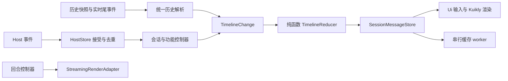

# 会话状态与连接边界迁移

基线：main 30a92c00bc98f1bfbdbd0f9b1135c6f800850580。开发分支：refactor/session-state-boundaries。

## 实际行为变化

- 切换会话和页面释放只 detach 手机观察者；停止按钮才发送 session.cancel。切回 running 会话时，从历史补齐后接管直播流。
- 重连由协议 phase/generation 判定，不再解析顶栏文案。新 READY 世代只触发一次恢复。
- 历史、模型、队列、goal、审批与问答回调校验会话选择版本和连接世代；历史/模型请求还有最新版本保护。
- 所有会话的 projection 先写 HostStore；重复 session/event 被拒绝后不再触发 UI 或流式累计。缺少序号的事件无法可靠去重，保留分发。
- 历史响应与请求期间已接受的实时尾事件按序号边界合并。历史解析保留部分文本/思考的位置，最终 assistant/message 替换对应占位，不把部分文本挪到工具卡片后面。
- 页面不再保存第二个 messages 引用，也不再通过 put() 修复引用。SessionMessageStore 是响应式消息列表的唯一写入入口，所有修改经过纯函数 TimelineReducer。
- 合帧和布局后的显示文本释放进入 StreamingRenderAdapter。业务根游标立即收尾，显示过渡仍等布局完成。
- DshConversation 从 46 个参数改为 5 组 UI 输入加宽度，不再接收业务 controller。getter 保留 Kuikly 响应式订阅。
- 会话缓存读写在同一个 Channel worker 串行执行。默认最多 16 个会话 / 200 万文本字符；当前和已挂载面板受保护，必要时允许超过软上限。只预热最近会话，其他按需读取。
- 附件按 Host scope、sessionId、attachmentId 隔离；缓存最多 32 张 / 1200 万 data URL 字符。单个超大图片允许暂时超限，避免无法显示。失败请求可重试，切页时清理。
- SSH 缓存身份包含实际端点，复用 default 配置槽改电脑时不会混用缓存。旧 ssh:default 缓存保留在数据库中，新身份首次联网后重新缓存。
- 连接页只验证/准备配置，首页建立一次 SSH。一次性配置在 Android/iOS 原生内存保留至消费或 60 秒过期；路由只传不透明标识，不传私钥口令。首页输入指纹确认；修改设置在原页重启。
- Android/iOS/Harmony Router 显式支持 replaceCurrentPage。连接页成功后被 Home 替换。Harmony SSH 仍不支持。
- 删除首页未接入口的私有会话重命名、归档、fork、导出和缓存读取方法；HostClient 对应协议能力仍保留。

## 当前边界

## 验证状态

本轮仅完成源码与调用链核对、Git diff 空白检查和远端分支核对。新增 14 个回归用例，未执行编译、单元测试、类型检查、lint 或真机验证；不能据此声称 Android/iOS/Harmony 构建通过。

新增用例覆盖观察/取消幂等、连接世代恢复、请求版本、事件重复和乱序接收、projection 顺序、SSH 缓存身份、目录标题刷新、时间线工具顺序、历史尾事件合并和部分思考保留。设备验证仍需覆盖：首字/Markdown、连续工具调用、中途停止、A→B→A、断网重连、加密私钥、首次指纹确认，以及返回键和连接设置重启。

## 后续迁移边界

本轮建立消息写入口与事件接受规则，尚未将所有功能状态迁成按会话保存的完整 actor。模型/队列编辑草稿仍在页面 controller 中，切换时重置；HostClient 仍是综合 facade；DshMessage 仍是现有字段模型。进一步拆窄能力接口、类型化消息和逐步合并完整回合 reducer，应在上述用例和设备行为验证后推进。没有修改三端 Relay 隧道协议与回环服务。

历史合并依赖协议 seq 的连续身份和历史快照尾序号；不处理服务端有意裁剪事件且无 watermark 的特殊快照，也不保证跨连接缺口之外所有乱序 chunk 都能按文本顺序重新排列。HostStore 接受迟到的唯一事件，以免直接丢掉合法工具事件；目前实时增量仍按到达顺序绘制。

缓存 worker 串行化的是会话缓存读写，配置/凭据数据库操作仍走原接口。原生配置交接和 Router 变化必须在对应设备验证后再合入 main。
